# Bass Something 2

Bass Something 2 turns the M-VAVE FM-1 into a monosynth inspired by the Novation Bass Station II. It has two oscillators
and a sub, a ring modulator and noise. The filter is Classic (low, band or high pass at 24 or 12 dB) or Acid (a
diode ladder), with drive and distortion. It has a mod envelope, an amp envelope, two LFOs, the Bass Station II's 32
arp rhythms with its 32-step sequencer (four sequences) and 128 named patches, as many as a Bass Station II holds. Patches go to and from a Bass Station II editor as SysEx. Everything
shows on the FM-1's screen as a small Bass Station II front panel. MIDI comes in over USB, Bluetooth and TRS, and
goes out over USB and Bluetooth.

A second instrument plays beside the synth: [Drum Something 400](#s6), 13 drums with their own sequencer and songs. A third, [Piano Something 368X](#rmi), is an electric piano, and [Space Something 201](#echo) is a tape echo and spring reverb that all three can send into.

It's also a companion for Cyma Forma's RND Synth (firmware 1.4): it keeps 32 of its patches as seeds with their locks
(type, key, tracks), sends them back, and mixes its four tracks (see [RND Synth](#s9)).

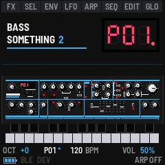
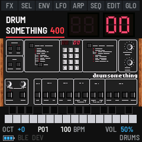
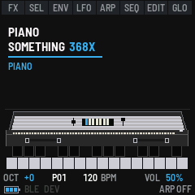
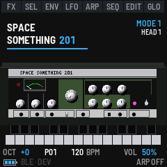

---

## Contents

1. Install
2. The screen
3. Playing
4. The sound
5. The arpeggiator and the sequencer
6. Drum Something 400
7. Patches and saving
8. SysEx: a Bass Station II editor
9. RND Synth
10. MIDI and audio
11. The screen reader
12. Troubleshooting
13. Credits

---

## 1. Install

**Try it first:** the emulator runs the same code in the browser, with sound. Play it with the mouse, a touch
screen or the computer keyboard.

**Install from the browser:** in Chrome or Edge, connect the FM-1 by USB, open the installer and press Install.
The browser asks once to allow MIDI: allow it. Don't unplug the cable while it writes.

**Install from a terminal:** `python3 tools/fm1_install.py bass-something-2-VERSION.fwsc`.

**On an iPhone or iPad, in RemoteFM1:** download `bass_something_2-VERSION.rfm1` from the release and put it in
RemoteFM1's firmware folder. It's the same firmware, running in the app as an instrument or an AUv3, with the panel,
the screen, sound and MIDI. There's no Bluetooth or USB host there, and the app keeps the saved patches and settings.

**Back to the stock firmware:** the installer's last section writes M-VAVE's own firmware back. An FM-1 that
doesn't start can be recovered too. For details, see felucca-bsp's `tools/fm1_rescue.sh`.

At power-on the screen shows BASS SOMETHING 2 in cyan, "Inspired by the Bass Station 2" under it, and an oscilloscope whose
wave morphs from sine to triangle to saw to a sweeping pulse. The firmware's version (such as v0.8) is in the bottom
right corner. v0.8 brings Piano Something 368X, Space Something 201, the motion recorder and PROX (`docs/RELEASE_v0.8.md`).
It uses 514,028 B of the FM-1's flash, with about 66 KB free. Then the panel opens on the patch you last saved. The emulator shows the same splash when you
switch it on.

---

## 2. The screen

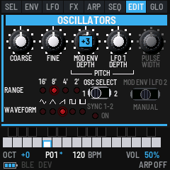

The screen is a small Bass Station II front panel. Every page is drawn as one of its sections (MASTER, OSCILLATORS,
SUB OSC + MIXER, FILTERS, ENVELOPES, PORTA, LFOS, EFFECTS, ARPEGGIATOR, the sequencer, GLOBAL, and the mods): its cyan bar with
the section's name, its knobs, switches and red LEDs, the print white. The panel starts right under the tabs, and a
knob shows its value in a cyan label on it while it turns.

| Part | What it shows |
| --- | --- |
| Section tabs | FX, SEL, ENV, LFO, ARP, SEQ, EDIT and GLO, the buttons. The section you're in is lit in the panel's cyan, its name white; the others are grey. ARP and SEQ are written in cyan while they play. |
| Panel | The section: its knobs, switches, LEDs and print, where the Bass Station II has them. A knob's line turns cyan, and its value shows in a cyan label on it, for a moment as it turns. |
| Keys | The 27 keys, black above white. A held key fills cyan to its velocity, and white over that shows its pressure. A key whose note is held from MIDI in is all cyan. |
| Bottom lines | Top line: OCT, the octave. P01 to P32, the patch, with * while it has changes that aren't saved. The tempo in BPM, cyan while the arp or the sequencer plays (MIDI clock's while it's followed). AFX while AFX mode is on. VOL, MASTER's volume. Bottom line: the battery (three bars when full, the outline red when it's nearly empty, a cyan bolt while USB powers the FM-1, as it can't tell charging from not, grey until its first reading). BLE, lit while a computer or phone is connected over Bluetooth, and DEV, lit while a Bluetooth MIDI device is. Where the last MIDI message came from (USB, BLE or TRS) and its bytes. At the right, what plays the keys: ARP OFF, ARP and its mode (ARP UP), SEQ PLAY, or SEQ REC with the steps recorded so far (SEQ REC 5/32), cyan while it plays. |

### The pages

Each section button opens its section's page. Press it again for its next page, where it has more.

The knobs speed up as you turn them faster: a slow turn moves a value one step a click, for fine setting, and a quick
spin takes it from one end to the other in a turn or two. Switches and short lists always move one position a click.
GLOBAL KEYS' KNOBS sets how much they speed up, from FINE to COARSE.

| Button | Page | Again |
| --- | --- | --- |
| HOME | HOME: the whole Bass Station II panel, as the sound is set (the page after the splash). On HOME, a tap goes round the instruments and Space Something, the camera panning down to the next one's panel: Bass Something 2, Drum Something 400, Piano Something 368X, Space Something 201, and back. From any other page, a hold switches at once | |
| SEL | MASTER: the patch, picked, saved and sent | |
| ENV | ENVELOPES: Env Select (PRESET) and the four faders | TRIGGERING; then the group's mods (velocity, retriggering, fixed sustain) |
| LFO | PORTA and LFOS: the glide, both LFOs' waves and knobs, the Delay/Speed switch | the group's mods (keysync, Speed/Sync, slew) |
| FX | FILTERS | LFO 2 on the filters; then EFFECTS: distortion and Osc Filter Mod; then the group's mods (key tracking, the VCA limiter), AFTERTOUCH and WHEELS |
| ARP | ARPEGGIATOR: tempo, rhythm, mode, octaves, the On and Latch buttons (held a second: AFX mode) | the group's mods (Seq Retrig, swing), then back |
| SEQ | SEQ: the sequencer (held a second: AFX mode) | recording on or off (the arp's REC) |
| EDIT | OSCILLATORS: the pitch's view | the pulse width's view; then SUB OSC + MIXER, beside them on a Bass Station II. Held a second: [a random sound](#a-random-sound) |
| GLO | GLOBAL MIDI CHANNELS (held a second: the RND pages) | GLOBAL CONNECT, then GLOBAL CLOCK, GLOBAL KEYS, GLOBAL AUDIO, GLOBAL DISPLAY and GLOBAL DUMP |

SEL opens MASTER on every page except where it has a job of its own, printed
on the page: GLOBAL DUMP, the RND pages, and SEQ while the sequencer records.

The buttons' lights: SAVE is lit while there's something to save, ARP while the arp is on, SEQ while recording,
and PLAY while the sequencer plays. The other buttons glow dimly, so they can be found in the dark.

As each page opens, its controls are labelled for a moment with the FM-1 encoder or button that sets them: SELECT,
ALGO, PRESET and K1 to K4 in cyan, and buttons (SEL, FX, SAVE) in white. The labels go after the pop-up time (a second and a
half unless you change it on GLOBAL DISPLAY), or as soon as you turn a knob. When you turn a knob, its value shows in
the same cyan label, on the control it sets, for the same time.

Each page uses the encoders as they sit on the FM-1. The knobs go right to left: a page with one knob sets it with
K4, two with K3 and K4, three with K2 to K4. The switches go to the encoders beside the screen (MASTER at the top
left, SELECT beside it, PRESET under MASTER, ALGO under SELECT): one switch is on PRESET, two side by side on PRESET
and ALGO, two one over the other on SELECT and ALGO, and three where they lie on the page.

**Hints** (GLOBAL DISPLAY, K3) add a few words on what each control does: under the value as you turn a
knob ("Filter cutoff", "Fade-in time", "Note order"), and over the keys as you press a button ("Save the patch").
A section's button (ENV, LFO, FX, EDIT, ARP, SEQ, GLO) names the page its next tap opens, from the page you're on,
and what holding it does: on GLOBAL MIDI CHANNELS, "GLO tap: Connect, hold: RND Synth Companion"; on GLOBAL CLOCK, "GLO tap:
Keys, hold: RND Synth Companion"; on ARP, "ARP tap: Arp Mods, hold: AFX mode". They're on until you turn them off, and the FM-1 remembers the setting.

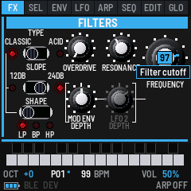

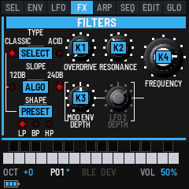

The keys light while their notes are held, whether you're playing them or they come in over MIDI. A note held below
the keys' reach lights OCT-, one above lights OCT+.

---

## 3. Playing

| Control | What it does |
| --- | --- |
| Keys | Play the voice, louder the harder they land. The last key pressed sounds, and the pitch glides to it if GLIDE is up. Each key also goes out as MIDI (see MIDI and audio). |
| OCT− · OCT+ | The octave, from −2 to +2. |
| SEL | MASTER, the patch page. On GLOBAL DUMP, the sound out as a SysEx dump instead; on the RND pages, their own (see RND Synth); on the SEQ page while the sequencer records, the step's legato (see SEQ). |
| MASTER | The volume. |
| REC | Recording on or off, from any page (see SEQ). On GLOBAL CONNECT it finds a Bluetooth MIDI device instead. |
| Hold EDIT | Held for a second: a random sound (see below), on every page. |
| Hold ARP or SEQ | Held for a second: AFX mode on or off. A shorter press opens the page as usual. |
| Hold GLO | Held for a second: the RND pages, for Cyma Forma's RND Synth; held again, back to GLOBAL. See RND Synth. |
| PLAY | Plays the sequence at its own key (the arp on, in PLAY), or stops it. |
| SAVE | Saves the sound into its patch, and the settings. |

The keys sense how hard they're played, with no change to the FM-1. The 20 lowest keys (F3 to C5) give velocity and
pressure; the top seven give velocity only. GLO KEYS' VELOCITY sets how the keys answer: SOFT (louder for a light
touch), NORMAL or HARD.

### A random sound

Hold EDIT for a second: the oscillators' waves, oscillator 2's tuning, the sync, the pitches' and pulse widths'
modulation, the widths, the filter (its type, frequency, resonance, overdrive and depths), the glide, the ring and the noise, both envelopes and both LFOs are set at
random. The filter is kept a little open and the attack under a second, so the result is heard at once. The screen
says SOUND RANDOMIZED, and for a second a card over the panel shows the randomizer at work: four knobs whirl
and stop one by one, and the letters on its label tumble until they spell RANDOMIZE. Oscillator 1's tuning and the ranges, the mixer's other levels, the arp and the sequencer are
left as they were. Hold EDIT again for another, or press SAVE to keep
it.

### Motion recorder

Records your knob moves as a loop and plays them back, apart from the notes. It records the bass's filter
Frequency, Resonance, arp Rhythm and arp Octaves; on the Space Echo its INTENSITY, REPEAT RATE, INSTRUMENT VOLUME, MODE SELECTOR,
REVERB VOLUME, ECHO VOLUME, the three sends and WOW; and on the drums each drum's VOLUME and TUNING and the roll key (which drum, how hard, when it starts and
stops). A roll the loop plays isn't recorded into the pattern, even in RECORD MODE; one you play is, as always. It records the
patterns you cue as the drums run, too, an improvised song: the loop cues them again at the same places, and cues the
pattern it began on in time for its top. Its cues wait while a song runs, or in RECORD MODE.

- **REC + OCT−** (hold REC, tap OCT− within a second): recording on. Turn the knob, then **REC + OCT−** again to stop.
  The first pass sets the loop's length, rounded up to whole bars (up to 16). Recording again overdubs: what you turn
  replaces what was there, the rest plays on.
- **REC + OCT+**: clears the moves of the instrument on screen (the bass's on its pages, the drums' on theirs, the
  echo's on its) and puts its knobs back where your hand left them; the others play on. The screen says BASS MOTION
  CLEARED, or EMPTY if it had none (the piano never has any).
- Both work on every page: the bass's, the drums', the piano's and the echo's.
- The loop runs on the clock the bass follows: MIDI clock if it's followed, else the drums while they run, else the
  arp or the sequencer. With nothing playing, it waits. Each time that clock starts, the loop starts from its top.
- Touching the knob while it plays takes it over until you let go.
- SAVE (the bass's or the drums'), and the echo's settings as they keep themselves, keep the knobs' own settings, not the loop's sweep. The loop is live only: switching off clears it.
- The combo leaves REC's own tap and hold, and the octave, alone.
- REC shows it in its own way: recording, it stays lit with a dark blink on each beat (a slow blink while it waits for
  a clock); a loop playing, a short flash at each bar and a double one at the loop's top. The bottom right of the
  screen says MOTION REC and the bar so far in red, MOTION WAIT, or MOTION and the bar playing of the loop's bars
  (MOTION 3/5) in cyan.

### AFX mode

Hold ARP or SEQ for a second to switch AFX mode on. The screen says AFX ON, and AFX stays lit at the bottom, left of VOL. Each
key then plays the sound with its own changes: oscillator 1's wave, the filter's cutoff, the decay of both envelopes
and the noise. For example, the lowest F is a dark, short sine, like a kick, and some keys add noise for snares and
hi-hats. Each key keeps its changes in any octave, and MIDI notes in play the key they'd be on the keyboard. The
patch itself doesn't change: switch AFX off (hold ARP or SEQ again) and the keys all play it as before. AFX is off each
time the FM-1 starts.

---

## 4. The sound

The signal goes: oscillators 1 and 2, the sub and noise → the mixer (or the ring modulator) → the filter, with its
drive in front (oscillator 2 moving its cutoff with Osc Filter Mod) → distortion → the amp envelope (the VCA) → the
limiter → MASTER. The mod envelope moves the pitches, the cutoff and the pulse
widths; LFO 1 the pitches, LFO 2 the cutoff and the pulse widths, as on a Bass Station II. Everything on these pages
belongs to the patch, and SAVE keeps it (but not the panels' switches that only pick what a knob sets: Osc Select, the
pulse width's switch, the mixer's).

The envelopes' times are the Bass Station II's: the attack from at once (0) through about 250 ms (64) to 5.5 s (127),
the decay through about 150 ms at the middle to 4.3 s, the release through about 360 ms at the middle to 10.5 s. A
depth of ±63 on an envelope or an LFO moves the cutoff over its whole range, or the pitch by 12 semitones.

Like an analog synth, the engine is never quite still. These behaviours are always on and have no controls:

- **Drift:** each oscillator's pitch wanders slowly by a cent or two, separately from the other one. Even at FINE 0
  the two oscillators beat gently against each other.
- **Free-running oscillators:** a new note doesn't restart the oscillators. Each attack begins somewhere different in
  the wave, so repeated notes vary a little, as they do on the Bass Station II.
- **Supply sag:** loud notes squash slightly, by about 1.5 dB at full velocity. Soft notes are unaffected.
- **Envelope curves:** attacks rise like a charging capacitor, fast at first and then easing into the top, so short
  attacks snap. Decays and releases fall the same way. The times on the knobs are unchanged.
- **Mixer warmth:** the oscillators, sub and noise are summed into a gentle, slightly lopsided saturation before the
  filter, even with DRIVE at 0. Loud peaks round off and stacked waves add a little grit and even harmonics.
- **Filter tolerance and heat:** like two analog units, every FM-1's cutoff sits slightly off the dial, by up to 1 %.
  A note held loud warms the filter over about half a minute, more with high resonance, and its cutoff drifts down by
  up to 2 %. It cools again over a minute or so once you stop.

### OSCILLATORS (EDIT)

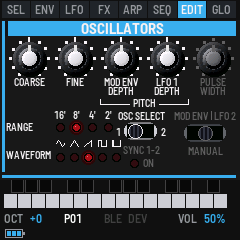

The Bass Station II's Oscillators section, with its five knobs, the Range and Waveform LEDs, Osc Select, Sync 1-2 and
the pulse width's switch. The sub oscillator, beside them on a Bass Station II, is on SUB OSC + MIXER, EDIT's third page.
The section has two views, EDIT and EDIT again: the pitch's and the pulse width's. Each shows the whole section, the controls the
encoders don't set in that view dimmed.

Osc Select (SELECT, in both views) switches every knob, the Range and the Waveform between oscillator 1 and oscillator 2.

| Control | Setting |
| --- | --- |
| SELECT · OSC SELECT | Which oscillator the page sets, 1 or 2. It isn't saved with the patch. |
| ALGO · RANGE | The oscillator's footage: 16', 8' (the note played), 4' or 2', its LED lit. |
| PRESET · WAVE | Its wave: sine, triangle, saw, square or pulse, its LED lit. |
| K1 · COARSE | The tuning, −12 to +12 semitones. The sub oscillator follows oscillator 1's. |
| K2 · FINE | The fine tuning in cents, −100 to +100. A few cents apart, the two oscillators beat. |
| K3 · MOD ENV | The mod envelope's depth on the pitch, −63 to +63 (12 semitones at full). |
| K4 · LFO 1 | LFO 1's depth on the pitch, −63 to +63 (12 semitones at full). |

#### The pulse width's view (EDIT again)

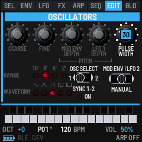

| Control | Setting |
| --- | --- |
| SELECT · OSC SELECT | Which oscillator, as on the pitch's view. |
| PRESET · SYNC | Sync 1-2: oscillator 2 hard-synced to oscillator 1, its LED lit. Sweep oscillator 2's Coarse or its Mod Env depth for the classic sync sound. |
| ALGO · PW SOURCE | The pulse width's switch, as on a Bass Station II: what the Pulse Width knob sets. Manual (the start) is the width, Mod Env the mod envelope's depth on it, LFO 2 LFO 2's. |
| K4 · PULSE WIDTH | Manual: the width, 5 to 95 %. Mod Env and LFO 2: their depth, −63 to +63 (±45 % at full). Each oscillator has its own three; the width counts when its wave is the pulse. |

### SUB OSC + MIXER (EDIT a third time)

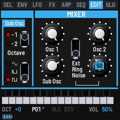

The page is laid out as that part of the Bass Station II's panel: the end of the oscillators' section, the Sub Osc with
its octave and wave switches (a red LED at what each is set to), then the MIXER, its four knobs with the switch that
picks what the fourth one sets. It starts right under the tabs, with no row for the page's name, so a knob shows
its value in a cyan label on it while it turns.

| Control | Setting |
| --- | --- |
| SELECT · OCTAVE | The sub oscillator's octave, −1 or −2 below oscillator 1. |
| PRESET · SUBWAVE | The sub oscillator's wave: sine, narrow pulse or square. |
| ALGO · SUB | The sub's level, 0 to 127 (the mixer's Sub Osc knob). |
| K1 · OSC1 | Oscillator 1's level, 0 to 127. |
| K2 · OSC2 | Oscillator 2's level. |
| K3 · SOURCE | The mixer's switch: what K4 sets, Noise, Ring or Ext. It isn't saved with the patch, like the switch on a Bass Station II. |
| K4 · Noise, Ring or Ext | The level the switch picks: the noise or the ring modulator (both kept by the patch), or Ext: the computer's sound over USB, through the filter and the amp (see USB audio in [section 9](#s10)). Ext is saved with the patch. |

### FILTERS (FX)

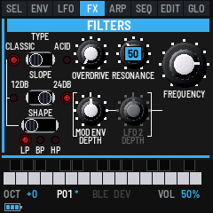

The Bass Station II's Filters section: the Type, Slope and Shape switches (Slope and Shape belong to the Classic
filter: the line from Classic joins them), Overdrive and Resonance, the Mod Env and LFO 2 depths bracketed to the big
Frequency knob. Two views: the filter's (FX) and LFO 2's on it (FX again). Key tracking, a setting on a Bass Station
II, is on the group's mods (FX a fourth time).

| Control | Setting |
| --- | --- |
| SELECT · TYPE | Classic: a ladder filter, low, band or high pass. Acid: a diode ladder's low pass, thinner, with its bass kept under the resonance, like a 303; its Slope and Shape go dark. Back to Classic, it's as it was. |
| ALGO · SLOPE | The Classic filter's slope: 12 or 24 dB an octave. |
| PRESET · SHAPE | The Classic filter's shape: low pass (LP), band pass (BP) or high pass (HP). |
| K1 · OVERDRIVE | Drive into the filter, 0 to 127. |
| K2 · MOD ENV DEPTH | How far the mod envelope moves the cutoff, −63 to +63 (its whole range at full). |
| K3 · RESONANCE | 0 to 127. Near the top the filter sings on its own, a clean sine at the cutoff. |
| K4 · FREQUENCY | The cutoff, 0 to 127: about 40 Hz to 17.8 kHz. |

#### LFO 2's view (FX again)

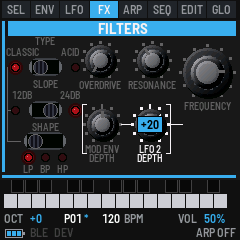

| Control | Setting |
| --- | --- |
| K4 · LFO 2 DEPTH | How far LFO 2 moves the cutoff, −63 to +63 (its whole range at full). |

### The mods

What Bass Something 2 has that a Bass Station II's panel doesn't, a setting there (its Function and On-Key settings)
or nothing at all, is on its own page: a plate screwed onto the panel, as a modification to a real one would be, brushed metal with Dymo-tape labels.
Each group has its mods as its last page, a press of its button after the others. Its knobs end at K4: two are on K3 and K4, three on K2 to K4.

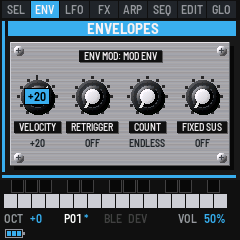

| Group | Page | Control | Setting |
| --- | --- | --- | --- |
| FX | FX MODS (fourth) | K3 · KEY TRACK | How far the cutoff follows the keys, 0 (not at all) to 7 (fully: an octave higher for each octave up). The cutoff is as set at C3. New patches start at 7, as on a Bass Station II. Patches saved before key tracking start at 0, so they sound as they did. |
| ENV | ENV MOD (third) | PRESET · ENV SELECT | Which envelope the plate sets (its title says): Amp Env, Mod Env, or Amp+Mod (both, the amp's shown). |
| ENV | | K1 · VELOCITY | How much a key's velocity sets it, −63 to +63. The amp envelope's: the volume, at +63 a soft note quiet and a hard one loud, at 0 every note as loud, below 0 reversed. The mod envelope's: its depths (on the pitches, the cutoff and the pulse widths), at +63 a hard note opening the filter further. |
| ENV | | K2 · RETRIGGER | On: the envelope starts again from its attack when its decay ends, a loop while the key is held. |
| ENV | | K3 · COUNT | How many times it retriggers: ENDLESS, or 1 to 16, then it stays in its sustain. |
| ENV | | K4 · FIXED SUS | Fixed-duration sustain, for drums: no decay, the sustain held for the Decay fader's time, then the release, whether the key is held or not. It overrides the retriggering. |
| LFO | LFO MOD (second) | PRESET · LFO | Which LFO the plate sets (its title says): LFO 1 or LFO 2. |
| LFO | | K2 · KEYSYNC | On: a note played on its own starts the LFO from its wave's start, so every note begins the same. |
| LFO | | K3 · SPEED/SYNC | Speed: its knob sets its speed. Sync: its knob sets a sync value instead, the LFO following the tempo. |
| LFO | | K4 · SLEW | 0 to 127: its edges softened, a square gliding from one level to the next (at the top, over about 2 s). |
| FX | | K4 · LIMITER | 0 (off) to 127: the Bass Station II's VCA limiter. The output's level held to a threshold that comes down as it goes up (to 24 dB under full), so a loud, resonant sound is kept in check: more compressed, and quieter. |
| FX | AFTERTOUCH (fifth) | K2 · FILTER | How far the keys' pressure moves the filter's frequency, −63 to +63 (below 0, it closes). At +63 full pressure opens it by half its range. Starts at +10, as on a Bass Station II's Init Patch. |
| FX | | K3 · LFO1 PITCH | How far pressure brings in LFO 1 on both oscillators' pitch (a vibrato at LFO 1's speed), on top of the patch's own LFO 1 depth: fine near 0, an octave at ±63. |
| FX | | K4 · LFO2 SPEED | How far pressure speeds LFO 2 up (or, below 0, slows it), up to 2 octaves of speed at ±63. |
| FX | WHEELS (sixth) | PRESET · BEND | The pitch bend's range, −24 to +24 semitones (below 0, reversed), as the title shows. Starts at 12, as on a Bass Station II. |
| FX | | K1 · FILTER | How far the mod wheel moves the filter's frequency, −63 to +63. |
| FX | | K2 · LFO1 PITCH | How far the mod wheel brings in LFO 1 on both pitches (vibrato): fine near 0, an octave at ±63. Starts at +10, as on a Bass Station II's Init Patch. |
| FX | | K3 · LFO2 FILT | How far the mod wheel brings in LFO 2 on the filter's frequency. |
| FX | | K4 · OSC2 PITCH | How far the mod wheel bends oscillator 2 alone: an octave at ±63. |

New patches start with the amp's velocity at +63 and the mod's at 0, as the FM-1 always played. A Bass Station II
patch brings its own.

The ARP group's mods (SEQ RETRIG and SWING) are with the arpeggiator, in section 5.

### ENVELOPES (ENV)

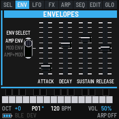

The Bass Station II's Envelopes section: Env Select and the four faders. Env Select picks which envelope the faders
set, as on a Bass Station II: Amp Env, Mod Env, or Amp+Mod Env, where a fader sets both envelopes to the same place
(and shows the amp's). It only picks what they set: the envelopes play as they are. It's on each of the section's
pages (the triggering and the mods set the envelope it picks too), PRESET moving it; ENV leaves it as it is, going on
to the section's other pages.

| Control | Setting |
| --- | --- |
| PRESET · ENV SELECT | Amp Env, Mod Env or Amp+Mod Env. |
| K1 to K4 | ATTACK, DECAY, SUSTAIN and RELEASE, 0 to 127. |

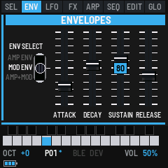

Each stage moves on from where the last one got to, so a quick retrigger or an early release doesn't click. The
velocities, the retriggering and the fixed sustain are on the group's mods (ENV a third time). The mod envelope's depths are where a Bass Station II has them:
on the pitches on the OSCILLATORS, on the pulse widths on their view, on the cutoff on the FILTERS.

#### TRIGGERING (ENV again)

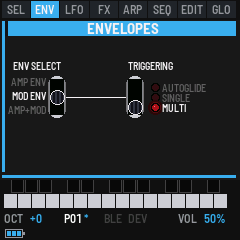

The Bass Station II's Triggering switch, for the envelope Env Select picks (each envelope has its own, kept with the
patch; Amp+Mod sets both):

| Control | Setting |
| --- | --- |
| PRESET · ENV SELECT | Amp Env, Mod Env or Amp+Mod Env. |
| K4 · TRIGGER | Multi: every note starts the envelope again, legato or not. Single: a note played on its own starts it; a note played legato (another key still held) doesn't, the envelope going on. Autoglide: as Single, and the glide is on legato notes only, a note on its own going straight to its pitch (either envelope at Autoglide does this). With Multi and Single the glide is on every note. New patches start at Multi. |

The arp's and the sequencer's notes each start the envelopes as their own notes (the sequencer's legato steps don't).

### PORTA and LFOS (LFO)

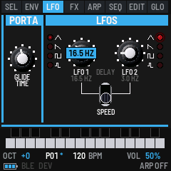

The Bass Station II's Porta and LFOs sections, side by side as on its panel. Each LFO has its wave button (four LEDs:
triangle, falling saw, square, sample and hold; the lit one blinks with the LFO) and one knob, which the Delay/Speed
switch sets: its speed or its delay. Under each knob is what it sets now.

| Control | Setting |
| --- | --- |
| PRESET · GLIDE TIME | PORTA's portamento: 0 jumps to each note; 1 to 127 glides, from 3 ms to 2.5 s. |
| ALGO · DELAY/SPEED | The switch: Speed (down) or Delay (up), for both knobs. It only picks what they set: both settings are kept. |
| K1 · WAVE 1 | LFO 1's wave: triangle, saw (falling, as the Bass Station II's), square or S&H (a new random level each cycle). |
| K2 · LFO 1 | At Speed, its speed, 0 to 255 as the Bass Station II's (about 0.2 Hz to 190 Hz: 3 Hz at 52, 7.9 Hz at 75; shown in Hz); with Speed/Sync at Sync (the mods), its sync value instead, a cycle from 64 beats (64b) to a 32nd-note triplet (32t), as the Bass Station II's display shows them. At Delay, its fade-in from a note, 0 (none) to 127. |
| K3 · LFO 2 | The same for LFO 2. |
| K4 · WAVE 2 | LFO 2's wave, the same. |

Synced, an LFO follows the tempo, or MIDI clock when it's followed (GLOBAL CLOCK's SYNC). A note played on its own
starts the delay's fade-in and, with keysync, the wave from its start; a note played legato doesn't. New patches start
as the Bass Station II's INIT PATCH: LFO 1 at 75 (7.9 Hz), LFO 2 at 52 (3 Hz) with keysync.

As on a Bass Station II, where each LFO goes is fixed, and its depths are set where it goes: LFO 1 moves the
oscillators' pitches (the OSCILLATORS' LFO 1 depth, one for each oscillator), LFO 2 the cutoff (the FILTERS' LFO 2
depth) and the pulse widths (the pulse width's switch at LFO 2).

Patches saved before this version had each LFO on a destination of its own. They're converted: an LFO 1 on the
pitch is on both oscillators, one on oscillator 2 on that one, and an LFO 2 on the cutoff is on the filter. An LFO 1
on the cutoff, or an LFO 2 on the pitch, has no place on a Bass Station II and is set to 0. A sine LFO (Bass Station
II LFOs have none) becomes a triangle.

### EFFECTS (FX a third time)

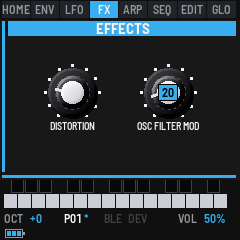

The Bass Station II's Effects section.

| Control | Setting |
| --- | --- |
| K3 · DISTORTION | 0 (none) to 127, made up so it stays about as loud. As on a Bass Station II it comes before the VCA, so its character doesn't change as the amp envelope fades. |
| K4 · OSC FILTER MOD | 0 (off) to 127: oscillator 2 moves the filter's frequency directly, at audio rate, up to 3 octaves either way at full. What it does depends on everything about oscillator 2 (its range, pitch, wave, pulse width and modulation) but not its level in the mixer: try it while sweeping oscillator 2's tuning. |

---

## 5. The arpeggiator and the sequencer

As on the Bass Station II, the sequencer is part of the arpeggiator. The arp's MODE has the Bass Station II's eight
positions: six arp modes, then PLAY and REC for the sequencer. Both play in the arp's RHYTHM, at its TEMPO and SWING,
or to MIDI clock when it comes in (see GLO CLOCK's SYNC).

### ARP

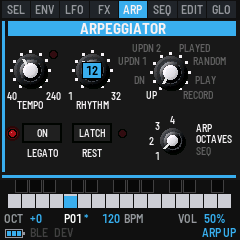

Press ARP to open its page. As on the Bass Station II's panel, the arp has its On and Latch buttons: turn PRESET up
to switch it on (the LED beside ON lights, and so does ARP), down to switch it off. While it's on, the notes you hold are played one
at a time over the octaves you set and in the rhythm you pick. It holds up to 16 notes, from the keys and from MIDI
in.

| Control | Setting |
| --- | --- |
| PRESET · ON | The arp on (turn up) or off (turn down). While the sequencer records, it's LEGATO instead (see SEQ). |
| ALGO · LATCH | Turn up for on (the LED beside LATCH lights): the notes keep playing after you let go, until you play a new chord, which replaces them. With the arp off, LATCH is the Bass Station II's key hold: the last note you played keeps sounding until you play another. While the sequencer records, it's REST instead. |
| K1 · TEMPO | 40 to 240 BPM. While MIDI clock is followed (GLO CLOCK's SYNC), the knob shows the clock's tempo, labelled MIDI CLOCK (dashes until it's measured), and turning it changes nothing. The patch keeps its own tempo for when the clock stops. |
| K2 · RHYTHM | The Bass Station II's 32 arp rhythms. Each is two bars of 16ths with rests and held notes. Rhythm 1 is two bars of quarter notes, and 32 plays every 16th. |
| K3 · MODE (ARP MODE) | UP, DOWN, UP/DN (the top and bottom notes once each), UP/DN2 (twice each), PLAYED (in the order played), RANDOM, PLAY (the sequencer plays) or REC (the sequencer records), named around the knob as on the panel. |
| K4 · OCTAVES | A four-position switch, 1 to 4 octaves, its positions on its left as on the panel. In PLAY and REC it's SEQ instead: which of the four sequences, as on the Bass Station II's switch. |

Press ARP again for the group's mods, two Bass Station II settings that aren't on its panel, and once more to come
back.

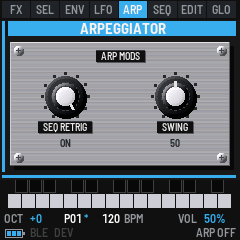

| Control | Setting |
| --- | --- |
| K3 · SEQ RETRIG | ON: the arp's notes, or the sequence, start again from the first every two bars, at the start of the rhythm. OFF: they run on across it. |
| K4 · SWING (ARP SWING) | 3 to 97 %. 50 is straight. Above it, the first 16th of each pair is longer and the second shorter. Below it, the reverse. |

### SEQ

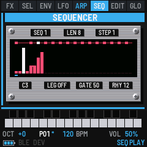

The sequencer plays a recorded sequence of up to 32 steps. Each step is a note or a rest, and a note can be legato.
The steps have no length of their own: **the arp's rhythm gives the timing**. Each note in the rhythm plays the next
step, its held 16ths hold the step on, and its rests are silent. The same sequence sounds different on every
rhythm, and SWING swings it.

Four sequences are kept, as on the Bass Station II. OCTAVES picks one in PLAY and REC (SEQ on this page does the
same). Each patch also holds a copy of the one it was saved with, so a patch brings its sequence back with it.

**Playing it:** with the arp on and in PLAY, hold a key. The sequence plays transposed from its first note, so the
key of that note plays it as it was recorded and each key above or below moves it by that many semitones. With
LATCH it plays on after you let go, and a new key transposes it. **PLAY** does this in one press: it switches the
arp on in PLAY and plays the sequence at its own key, and PLAY again stops it (and switches the arp off). A key
pressed while it plays transposes it.

**The length and the rhythm:** a sequence is as long as the number of steps recorded, and a rhythm is 8 to 32 notes
long, so they often differ. With SEQ RETRIG ON, the sequence starts again from its first step every two bars, even if it
hasn't finished. With SEQ RETRIG OFF, it plays all the way through and wraps around the rhythm. An 8-step sequence on a
16-note rhythm plays twice in the two bars. That's how a short sequence fills a longer pattern, as on the Bass
Station II: the sequencer has no empty steps to fill.

**Recording:** press REC on any page, or SEQ again on the SEQ page (MODE goes to REC, and SEQ and REC light). The
bottom line's SEQ REC counts the steps recorded so far (SEQ REC 0/32 until the first note). The first note you play
starts a new sequence from step 1. Each key, or each note from MIDI in, is the next step, and the screen shows it
(STEP 3 G3). The keys play the voice as you go.

| Button | While recording |
| --- | --- |
| FX on the SEQ page, or ALGO turned up on the ARP page | A rest (the Bass Station II's REST). |
| SEL on the SEQ page, or PRESET turned up on the ARP page | Makes the step just recorded legato (the Bass Station II's LEGATO). That note is held into the next one, which plays without a new attack. The same note on both sides makes a tie: one note held over both steps. Again cancels it. A rest can't be tied. |

Recording stops at 32 steps (SEQ FULL). Press REC, or SEQ on the SEQ page, again to stop: MODE goes to PLAY. Leaving REC before playing a note
keeps the sequence as it was.

| Control | Setting |
| --- | --- |
| PRESET · SEQ (SEQUENCE) | Which of the four sequences: turning it loads that one into the patch. |
| SELECT · LENGTH (SEQ LENGTH) | The steps that play, 0 to 32. Lengthen it and the steps after the old length come back as they were last recorded (rests on a new sequence). |
| ALGO · STEP | The cursor: which step K1 and K2 edit (white in the picture). |
| K1 · NOTE | The step's note, from REST up through the notes. |
| K2 · LEGATO | The step's legato, ON or OFF. |
| K3 · GATE | How long each note sounds, 5 to 100 % of its 16th (an FM-1 extra; the arp's notes too). |
| K4 · RHYTHM | The arp's rhythm, the same as ARP's K2: the sequence plays in it. (TEMPO is on the ARP page.) |

The plate's display shows the rhythm as a row of lights over the 32 steps: a lit light is a 16th that plays a note.
Under it each step is a bar, its height the note's pitch, a legato note joined to the next. A mark under the bars
shows the step playing, and the cursor's step is white. Steps past the length are dark.

**The sequences are kept by themselves:** two seconds after you last change one, once the FM-1 is quiet, the four
sequences and the patch's copy are written to memory (with which of the four it plays, the gate, the tempo and the
swing), so they're still there after power-off without SAVE. Turning PRESET to another patch keeps them first. The
rest of the sound still needs SAVE.

Writing to the FM-1's memory stops the sound for a moment, so it waits for silence: the sequencer stopped, the arp
with no notes, no key held and the last note faded out, for half a second. Change TEMPO while the sequence plays and
it's kept when you stop it. Switch off while it's still playing and those changes are lost: stop first. SAVE and
turning PRESET write at once, so pressing SAVE mid-performance gives a short gap.

---

## 6. Drum Something 400

Drum Something 400 is a second instrument on the FM-1, inspired by the Sequential Circuits Drumtraks: 13 drums on six channels, 99
patterns and 99 songs. It plays beside the synth, on the same output, with its own MIDI channels. Its sounds are
synthesized for this firmware and stored as 8-bit tables that play faster or slower as you tune them, so the firmware
contains no samples of the original.

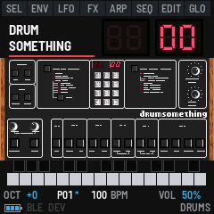

Tap HOME on HOME to go round the instruments: Bass Something 2, Drum Something 400, Piano Something 368X (see [Piano Something 368X](#rmi)), Space Something 201 (see [Space Something 201](#echo)), and back. From any other page, hold it for a second. In Drum Something 400, every button
does a drum job, listed below, and the keys play the drums.

### Its keys and channels

The drums start at the low C and go up the white keys. The first black key is ACCENT: hold it for an accented hit.

The lowest F is ROLL: hold it and the selected drum repeats at the rate set on the ROLL plate (SEQ, after COPY / APPEND TO). Tap another drum while holding to roll that one. ACCENT works when pressed before ROLL. While recording, the roll is recorded, on the pattern's Error Correct grid: at 1/96 every hit is kept, and a coarser grid keeps fewer. A hit on a spot where that drum already has one replaces it, so the pattern's hit count may not change.

| Channel | Keys and drums |
| --- | --- |
| 1 | C: Bass |
| 2 | D: Snare, E: Rim |
| 3 | F: Tom 1, G: Tom 2 |
| 4 | A: Crash, B: Ride |
| 5 | C: Closed Hat, D: Open Hat |
| 6 | E: Claps, F: Tambourine, top F#: Cowbell, top G: Cabasa |

A channel plays one drum at a time, as on the original: a hit cuts off whatever that channel is playing, so an Open Hat is
choked by a Closed Hat. Different channels sound together.

### Its controls

These do the same job on every drum page, unless the page says otherwise:

| Control | What it does |
| --- | --- |
| K1 | METRONOME: the click's level |
| K2 | MASTER: all the drums' level, under the FM-1's MASTER, so you can set the drums against the synth |
| K3 | VOLUME of the last drum you tapped, 0 to 15 |
| K4 | TUNING of the last drum you tapped, 0 to 15 |
| SELECT | TEMPO, one of the 91 tempos of the original |
| PRESET | The pattern or song number, or what the lit function picks |
| ALGO | The value of the lit function |

Tapping a drum selects it for K3 and K4. On HOME, those two knobs zoom in to the drum's Channel page and back out a second after you stop, unless KNOB ZOOM is OFF.

| Button | Tap | Again or held |
| --- | --- | --- |
| HOME | Drum Something 400's HOME | On HOME, a tap switches to the synth. Held a second elsewhere: the same |
| EDIT | The selected drum's Channel page | The next drum, moving page at each new channel |
| SEQ | The PATTERN page | The next pattern function |
| ARP | The SONG page | The next song function |
| ENV | The pattern's bars | Its time signature |
| FX | DRUM MODS | DRUM ROOM, then PATTERN INFO, then SONG INFO |
| GLO | GLOBAL MIDI CHANNELS | The other global pages (no DUMP). Held a second: the RND pages |
| SEL | ENTER: does what the lit function asks | |
| PLAY | Run or stop, on any page | |
| REC | Recording on or off, on any page | Held a second: Erase Instrument |
| OCT− and OCT+ | A slower or a faster tempo | Both held, stopped: the memory left, as a percentage |
| SAVE | Saves the drums, once they're stopped | |

A Channel page gives the whole panel to the channel, with no header. Turning PRESET, ALGO, SELECT, K1 or K2 drops the header down with its two displays, showing the value; it goes back up a second after the last turn. K1 shows as C and K2 as U, then the number. K3 and K4 show on the page's own dials.

")

### Recording a pattern

1. Press SEQ and turn PRESET to an empty pattern (00 to 98). A new pattern is one bar of 4/4. To change that, press ENV and turn ALGO for the bars; press ENV again for the time signature (PRESET the beats, ALGO the note).
2. Press REC, then PLAY. The click plays on each beat.
3. Play the keys. Each hit joins the loop and is heard from the next pass.
4. Press REC to stop recording while the pattern plays on, or PLAY to stop it all.
5. Press SAVE. Anything not saved is gone at the next restart.

Hits land where you played them. To pull them to a grid, set Error Correct, from 1/2 down to 1/48; 1/96, the default, leaves them as played.

To take a drum out, hold REC for a second: REC pulses twice each beat and the keys go silent. Hold a drum's key as the loop passes and its hits are erased. Tap REC to go back to recording.

A pattern with hits can't change its length: erase it first, or make it longer with COPY / APPEND.

To lock a drum's level and tuning into a pattern, press REC while stopped and tap the drum's key. Its hits then keep that Volume and Tuning. Other drums follow their knobs as they play.

")

SEQ steps through the page's list:

| Function | Turn | SEL |
| --- | --- | --- |
| PATTERN # | PRESET: the pattern. While one runs, the next one, which starts when this one ends. Pattern 99 is always empty, so cueing it stops at the end | |
| RECORD MODE | | |
| ERASE INSTRUMENT | | |
| ERROR CORRECT | ALGO: the grid | |
| SWING % | ALGO: 50 to 70 %, in patterns counted in quarter notes, whenever you like, even running or recording | |
| TIME SIGNATURE | PRESET the beats, ALGO the note. Empty patterns only | |
| # OF MEASURES | ALGO: the bars. Empty patterns only | |
| ERASE PATTERN | ALGO: which | Erases it, back to one bar of 4/4 |
| COPY / APPEND TO | ALGO: where to, starting on this pattern | On an empty pattern, a copy with its settings. On one with hits, added after them, in its own settings. There's no undo. The hint says what happened: `Copied to 05`, `Added to 05`, or why not, `Nothing to copy`, `Memory full` or `Pattern too long` |
| ROLL | ALGO: the rate of the ROLL key: 1/2, 1/4, 1/4T, 1/8, 1/8T, 1/16 (the default), 1/16T, 1/32, 1/32T. Also while running. Stopped, like ERROR CORRECT, it arms recording: PLAY records | |

While a pattern runs, SEQ only moves between the number, the swing and Roll. While it records, SEQ goes round Record, Erase, Error Correct, Swing and Roll. PATTERN INFO (FX, three times) shows the pattern's settings, its hits and the memory left, shared by all the patterns: about 4,000 hits.

### Songs

A song plays a list of up to 100 steps, each a pattern, a volume change or a tempo change. There are 99 songs, 00 to 98.

")

Press ARP and turn PRESET to pick a song. PLAY runs it. Press ARP again for ERASE SONG and COPY / APPEND TO, which work like the patterns', then BUILD MODE. A song copied onto an empty one brings its first tempo; added after another's steps, that song keeps its own. A song holds up to 99 steps, and a copy that wouldn't fit says `Song too long` and changes nothing.

To build one, press SEL on BUILD MODE, then:

1. Turn ALGO to a pattern and press SEL. It goes into this step and moves on to the next.
2. Repeat for each pattern. An empty pattern, such as 99, stops the song there; otherwise it plays round again.
3. Press SEL with no new value to leave Build Mode.

In Build Mode, PRESET moves through the steps and ARP goes round its functions:

| Function | What it does, with SEL |
| --- | --- |
| PATTERN # | The step's pattern. |
| VOL CHANGE | A step that changes the song's level, ALGO −15 to +15. |
| TEMPO CHANGE | A step that changes the tempo, ALGO −15 to +15 tempos. At step 00, ALGO sets the tempo the song starts at. |
| INSERT | A blank step here, to fill or leave. |
| DELETE | Takes this step out. |

Changes add up as the song loops. Stop a song before you build it. While it runs, PRESET cues the next song.

### With the synth

There is one clock. While a pattern runs, the synth's arp and sequencer follow the drums' tempo, without changing the patch's own tempo. FX opens DRUM MODS:

| Control | What it does |
| --- | --- |
| K3 · SWING LOCK | OFF (the default): each has its own swing. ON: the synth's 16ths follow the running pattern's swing |
| K4 · TRANSPORT | ON (the default): the drums' run and stop also start and stop the synth's arp or sequence. OFF: each runs on its own |

")

FX again opens DRUM ROOM, the small room the drums ring in. Each knob starts at 64, the room as modelled. The settings are kept through a restart.

| Control | What it does |
| --- | --- |
| K1 · DECAY | The tail's length, 0.11 to 1.74 seconds (0.45 by default). |
| K2 · TONE | The tail's brightness: lower is a softer, more damped room. |
| K3 · INPUT TONE | How bright the hits are going into the room. |
| K4 · LEVEL | The room's level, from off to about twice the default. Each drum's own send into the room stays as voiced. |

")

### MIDI

Drum Something 400 is a MIDI device of its own. GLOBAL MIDI CHANNELS (GLO) sets its note channel and its CC channel, both 10
by default, in its DRUMS column.

| Control | What it does |
| --- | --- |
| K3 · DRUMS | The drums' note channel, in and out: ALL, OFF or 1 to 16. On the synth's channel, one note plays both. |
| ALGO · DRUMS CC | The channel for the drums' CCs: volume, tuning and the roll. |

Notes play each drum, and the keys and patterns send them too: Bass 36, Rim 37, Snare 38, Claps 39, Tom 1 41, Closed Hat 42, Tom 2 45, Open Hat 46, Crash 49, Ride 51, Tambourine 54, Cowbell 56, Cabasa 58. Velocity 120 and up is an accent.

CCs 33 to 37 and 39 to 46 set each drum's volume and 48 to 60 its tuning, in the order Bass, Snare, Rim, Tom 1, Tom 2, Crash, Ride, Closed Hat, Open Hat, Claps, Tambourine, Cowbell, Cabasa. MIDI Start and Stop run the drums.

The roll works over MIDI too, by CC on the drums' CC channel (not by a note): CC 66 at 64 and up is the ROLL key held, rolling the selected drum at velocity 100, and below 64 lets it go. A drum's note while it's held rolls that drum instead, at the note's velocity, as tapping a drum with ROLL held does. CC 67 sets the roll's rate across its list (0 is 1/2, 127 is 1/32T).

---

<a id="rmi"></a>
### Piano Something 368X

The third instrument, Piano Something 368X, is after the RMI Electra-piano 368X, the 1970s electronic piano with
its seven stop toggles: a piano, a harpsichord and a lute, each from its own tone generator per key, polyphonic (eight
notes at once here). Tap HOME on Drum Something 400's HOME to reach it. Its HOME has its name, the tone toggles down (with ORGAN MODE and
ACCENTER when down) and its stop strip down on the keys (the FM-1's keys are its keyboard); between them its notes as they
ring, each a bar over its key's place as tall as its level, a mark falling slowly from the most it reached.

**PIANO PRESETS** (SEL) shows the toggles' section whole, BASS and VOL beside it; turning a knob there dives in on
it, as on HOME. **PIANO PANEL** (SEL again; SEL there moves along the toggles) is the stop strip up close, BASS slider at the left, the toggles, VOL at the right:

| Control | What it does |
| --- | --- |
| SEL, PRESET | The tone toggles, as the 368X's: SEL moves the cursor (a cyan outline) along PIANO, PIANO PP, HARPSI, HARPSI PP, LUTE, ORGAN MODE and ACCENTER, the panel sliding to it; PRESET turns that toggle on (right) or off (left). K2 and K3 also switch ORGAN MODE and ACCENTER. Any of them can be down at once, their sounds layered as the 368X layers them: PIANO with HARPSI is its "honky-tonk". PP is pianissimo, very soft: the same tone, about 14 dB down. |
| K1 · BASS | The bass boost, around 98 Hz: the middle is none, up boosts, down cuts. |
| K2 · ORGAN MODE | Notes hold while their keys do, with a slow fade, instead of a piano's decay. |
| K3 · ACCENTER | A thump at the start of each note, as the 368X's keying made it, under the harpsichord and lute voices (the low keys, to A#2, have their own). |
| K4 · VOL | Its own volume. The FM-1's MASTER knob is the master over all three instruments. |

On its HOME, PRESET and K1 to K4 do the same, the camera zooming in on the panel as they turn. It answers the
keys' touch (the 368X didn't): the softest note at about a third of the hardest, through GLO KEYS' Velocity
curve. The panel keeps itself with the GLO settings, so SAVE has nothing to do here.

It is a MIDI device of its own, as the drums are: its channels are in GLOBAL MIDI CHANNELS' PIANO column, ROUTE is on
GLOBAL KEYS.

| Control | What it does |
| --- | --- |
| SELECT · PIANO CC (GLOBAL MIDI CHANNELS) | The channel its CCs come in on, and the Space Echo's (section 10's numbers, its sends with them): OFF, 1 to 16 or ALL. 3 by default. |
| K4 · PIANO (GLOBAL MIDI CHANNELS) | The channel its notes come in on and its keys' notes go out on. 3 by default. |
| K4 · ROUTE (GLOBAL KEYS) | Notes from one instrument to the other, inside the FM-1: OFF, PIANO>BASS, BASS>PIANO or BOTH. |

Its CCs: 11 its volume (MIDI's Expression; 7 is the bass's), 64 the sustain pedal, 61 PIANO, 62 HARPSI, 63 LUTE, 65
ORGAN MODE and 68 ACCENTER (each down at 64 and up), 69 its BASS slider. PIANO PP and HARPSI PP have no CC.

PIANO>BASS sends its notes, from its keys and its channel, into the bass as if played on the bass's keys. With the
bass's ARP on, a chord on the piano becomes a bass arpeggio; without it the bass, being mono, plays one note of the
chord. BASS>PIANO plays what the bass plays on the piano too: its keys, its MIDI channel, its arp and its sequencer. BOTH
does both, and can't loop: a routed note is never routed again or sent out over MIDI, and while the piano is playing
the bass, the bass sends nothing back.

#### The piano's part

Each drum pattern (00 to 98) has a piano part beside its drums, played with it and saved with it.

| Button (piano pages) | Tap | Held a second |
| --- | --- | --- |
| REC | Records the piano into the pattern playing. With the drums stopped, the pattern shown on the drums' pages starts. Again: recording off | Erase: hold a key as the loop passes its notes, and they're gone. The keys stay silent while erasing; tap REC to record again |
| PLAY | The piano's part on or off, the drums playing on. With the drums stopped, they start with it | Undo: the last pass you recorded notes in is taken back |
| SAVE | Saves the drums' patterns and songs with the piano's parts (stopped only) | |
| SEQ | | Clears the pattern's piano part, whole (the pattern playing, or the one shown) |

Recording adds to what's there (overdub), on the pattern's Error Correct grid, its swing and length. The metronome
clicks while it records. In a song, recording follows the patterns as they change: a pattern that comes back in the
song takes both passes. A note still held as the pattern changes ends at its end. The sustain pedal (CC 64 on the
piano's CC channel) is recorded too. The part plays on the piano, out on its MIDI channel (GLOBAL MIDI CHANNELS), and through
ROUTE: with PIANO>BASS on, the part plays the bass as well. ERASE PATTERN and COPY PATTERN on the drums take the
piano's part with the drums'. The parts hold about 1,850 notes in all.

Its sound is synthesised, each key's tone and decay modelled on recordings of a real 368X; its tail is the room
Drum Something 400 uses. LUTE is the harpsichord's tone through the 368X's lute filter (a low pass about 1.3 kHz),
its level set by ear, as is how much softer a PP toggle is: the recordings can't measure those.

<a id="echo"></a>
### Space Something 201

Space Something 201 is a tape echo and spring reverb after the Roland RE-201 Space Echo, the 1974 tape loop with
three playback heads and a three-spring reverb tank. It isn't an instrument: the synth, the drums and the electric piano
each send into it, and it plays back on the master. Tap HOME on Piano Something 368X's HOME to reach it; the keys go
on playing the electric piano there. Its HOME has its name, the mode (which heads, and the spring) and the whole front
panel, its knobs as they're set, its VU meter and PEAK lamp live.


How it works, as the RE-201 does:

- **The tape.** One loop, one record head, three playback heads. REPEAT RATE is the motor's speed: head 1 is 175 ms
  at its slowest and 60 ms at its fastest, heads 2 and 3 at 1.91 and 2.88 times that (up to about half a second). The
  motor takes a moment to reach a new speed, so turning REPEAT RATE while it repeats bends the pitch, as the tape does.
- **The repeats** come round through INTENSITY, saturated as tape is and a little darker each time (darker still at
  slow speeds). Past about 7 they build on themselves into a runaway that holds at the tape's limit. With more than
  one head playing (modes 4 and 8 to 11) the heads add up, so it runs away sooner.
- **BASS and TREBLE** shape the echo as you hear it, not the repeats in the loop, as on the RE-201.
- **The spring** (modes 5 to 12) is fed by the dry sends only: the echoes don't go into it. Mode 12, REVERB ONLY, is
  the spring alone, the tape stopped.

| Mode | Heads | Spring |
| --- | --- | --- |
| 1, 2, 3 | 1, 2, 3 | |
| 4 | 2 and 3 | |
| 5, 6, 7 | 1, 2, 3 | yes |
| 8 | 1 and 2 | yes |
| 9 | 2 and 3 | yes |
| 10 | 1 and 3 | yes |
| 11 | 1, 2 and 3 | yes |
| REVERB ONLY | none | yes |

SEL goes round its three panels. On HOME, PRESET and K1 to K4 set the same as on its panels, the camera diving in on
the knob as it turns.

| Page | Control | What it does |
| --- | --- | --- |
| HOME | PRESET · MODE | The MODE SELECTOR: 1 to 11 and REVERB ONLY |
| HOME | K1 · REPEAT RATE | The tape's speed: the time between repeats |
| HOME | K2 · INTENSITY | How much of the echo goes round again |
| HOME | K3 · ECHO VOLUME | The echo's level |
| HOME | K4 · REVERB VOLUME | The spring's level |
| ECHO INPUT | PRESET · MODE | As on HOME |
| ECHO INPUT | K4 · INPUT | How hard the sends drive the tape (INSTRUMENT VOLUME on the RE-201). The VU meter shows it; PEAK lights near the tape's limit |
| ECHO PANEL | PRESET · BASS, ALGO · TREBLE | The echo's lows and highs, about 10 dB either way |
| ECHO PANEL | K1 to K4 | As on HOME |
| ECHO MODS | PRESET · TEMPO SYNC | REPEAT RATE picks a note at the tempo instead (an 8th, an 8th triplet, a 16th, a 16th triplet or a 32nd, slow to fast), halved or doubled to stay in the RE-201's range |
| ECHO MODS | K1 to K3 · BASS, DRUM, PIANO SEND | How much of each instrument goes into it, after its own volume. All three are off at first |
| ECHO MODS | K4 · WOW | The tape's wobble, from none to a worn machine's; 13, the default, a well-kept one's |
| ECHO VOICE | SELECT · FEEDBACK | INTENSITY's loop gain, x0.5 to x1.5: where the repeats run away |
| ECHO VOICE | ALGO · MULTI-HEAD | The feedback again when two or three heads play (modes 4, 8 to 11), x0.5 to x1.5: below x1, a mode with more heads runs away no sooner than one head |
| ECHO VOICE | PRESET · SATURATION | Where the tape compresses, x0.25 (early, thick) to x4 (late, clean) |
| ECHO VOICE | K1 · WOW DEPTH, K2 · FLUTTER | The WOW mod's slow drift and its fast warble, each x0 to x2 |
| ECHO VOICE | K3 · SPRING DRIP | The spring's chirp, its dispersion: 0.30 (soft) to 0.90 (a sharp boing) |
| ECHO VOICE | K4 · SPRING DECAY | The spring's tail, 5 % shorter to 5 % longer a round trip (it can't run away) |

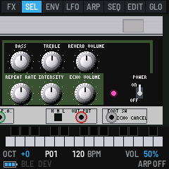

**ECHO VOICE** (SEL after ECHO MODS) voices the model to taste; every value at 64 (x1.00) is the sound as modelled.

Its knobs keep themselves with the GLO settings, so SAVE has nothing to do here, and MIDI CCs set them too (see
[Control changes](#cc)). Its sound is modelled on measurements of a software RE-201, AudioThing's Outer Space 2, and
on Roland's own service notes and owner's manual.

## 7. Patches and saving

Bass Something 2 holds 128 patches, P01 to P99 and then 100 to 128 (the display has three digits, as a Bass Station
II's). Each patch is a complete sound: the settings of every control described in [section 4](#s4), plus the arp and
the sequence, and a name of up to 16 characters.

A new Bass Something 2 starts with 32 factory patches of its own in P01 to P32, each with the default sequence, and
the INIT patch, named INIT, in P33 to P128. Updating from a firmware with 32 patches keeps yours in P01 to P32 and
adds the INIT patches after them; until you name them, your 32 have no name. P01 to P10 are
basses, P11 to P20 leads, and P21 to P32 show off the rest of the voice:

| Patch | Name | What it shows |
|---|---|---|
| P01 | DUB PLATE | two saws and a loud sine sub under the 24 dB filter, swept slowly by LFO 2 |
| P02 | STATION BASS | the classic: two saws at 16', the square sub, a short filter envelope |
| P03 | ACID SLIDE | the Acid filter with high resonance; overlap the notes to slide |
| P04 | RUBBER PLUCK | a narrow pulse through the 12 dB filter, short and round |
| P05 | REESE TUNNEL | two detuned saws beating, the cutoff breathing slowly |
| P06 | FM GROWL | Osc Filter Mod: oscillator 2 moving the cutoff at audio rate |
| P07 | WOBBLE DUB | LFO 2 on the cutoff, synced to eighths of the tempo |
| P08 | SYNC PUNCH | hard sync, the mod envelope sweeping oscillator 2 down |
| P09 | GRIT BASS | squares and the sub through the drive and the distortion |
| P10 | BOOM 808 | a sine that drops into its note with a long decay: a tuned kick |
| P11 | BRIGHT SAWS | two open saws, glide on legato notes, delayed vibrato |
| P12 | SQUARE SOLO | a square with another an octave up, hollow and woody |
| P13 | SYNC SCREAMER | hard sync with the mod envelope on oscillator 2's pitch |
| P14 | PWM LEAD | two pulses, their widths swept by LFO 2 in opposite directions |
| P15 | ACID SCREAM | the Acid filter high and near self-oscillation, driven |
| P16 | FIFTH ELEMENT | oscillator 2 a fifth up: a power chord from each note |
| P17 | RING LEAD | ring modulation for a metallic edge |
| P18 | PORTA SINE | a soft sine and triangle that always glide, slowly |
| P19 | HOT WIRE | a saw and a pulse pushed hard through drive and distortion |
| P20 | BREATHY FLUTE | a triangle with noise, a slow attack and delayed vibrato |
| P21 | ARP PLUCKS | the arpeggiator up two octaves in rhythm 8: hold a chord |
| P22 | ARP RANDOMIZER | random notes over three octaves, latched, sample and hold on the cutoff |
| P23 | S&H COMPUTER | sample and hold on a resonant filter: 70s computer bleeps |
| P24 | SLOW SWEEP PAD | detuned saws, slow attack and release, the cutoff swept slowly |
| P25 | LASER ZAP | the mod envelope drops the pitch an octave into the note |
| P26 | RING BELLS | two oscillators ring-modulated a fifth apart, decaying like a bell |
| P27 | WINDY NOISE | noise through a resonant band pass that drifts: hold a key |
| P28 | STUTTER GATE | the envelopes retriggering: each note chopped |
| P29 | FM METAL | Osc Filter Mod at full with an odd interval: metallic clangs |
| P30 | HIGHPASS PLUCK | the high pass filter thinning a plucked saw |
| P31 | SIREN SWEEP | LFO 1 on both oscillators' pitches: a siren on every key |
| P32 | TALKING WAH | the band pass opening and closing on each note |

Updating the firmware keeps the patches you have. To get the factory ones back, send the factory bank,
`bs2/presets/factory.syx` in the source (see [SysEx](#s8)).

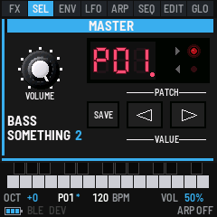

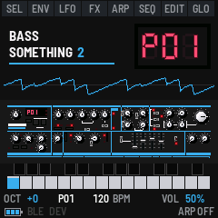

The HOME page (HOME) is the page Bass Something 2 starts on: the name, the patch in large red digits, a scope that draws
the synth's wave as it plays (two of its periods, standing still while a note is held, scaled so a quiet sound shows as
large as a loud one; a flat line in silence), and under them a Bass Station II's whole front panel, drawn to the scale of the keys
at the foot of the screen (they stand for its keys and its wheels together). Every knob, fader, switch and LED on it
shows the sound as it is set, and follows it as you change it on the other pages. PRESET picks the patch here, as on
MASTER. K1 is the bass's own volume, as the MASTER page's Volume. K2 sets the arp's Rhythm, K3 the filter's Resonance and K4 its Frequency: the panel zooms in to that knob on its
page (ARP or FILTERS) as you turn it, and back out to HOME a second after you stop. A section's button (FX, SEL, ENV, LFO, ARP, SEQ or EDIT) zooms in on that section of the
panel and opens its page; any button or knob on the way gets you there at once. HOME on that page does the reverse: the
panel appears up close on the section and zooms back out. GLOBAL DISPLAY's KNOB ZOOM OFF makes both changes straight away.

The MASTER page (SEL) is the Bass Station II's Master section: the Volume
(the bass's own volume, K1), the display with the patch in red, its dot lit while there are changes not
saved, the Org. Value arrows, the Save button and the Patch buttons.

The Org. Value arrows, right of the display, work as the Bass Station II's: after you change a control of the sound
(a knob, or a control change from MIDI), the LED beside one arrow lights to show which way to turn that control to
get back to the value saved in the patch. Neither lights when it's there, after SAVE, or after a patch change. They
follow the control changed last, on whichever page. The display shows that control's value (0 to 127, or -63 to
63) for a moment and a half after the change, then the patch number again.

| Control | What it does |
| --- | --- |
| K1 | Volume: the bass's own volume, 0 to 127 (127, full, is the default). It's kept with the GLO settings, not the patch, like a mixer's fader: the drums have their own (their MASTER VOLUME) and the FM-1's MASTER knob is the master over everything. |
| PRESET | The Patch buttons: picks a patch, P01 to 128, and plays it at once; the button the way you turned lights. Changes you haven't saved to the patch you leave are lost. An arp or a sequence that is playing keeps playing, in the new sound. |
| SAVE | Stores the sound into the patch shown. |

**PATCH NAME** (SEL again on the MASTER page; SEL once more goes back) is the patch's mod: a Bass Station II has no
way to name a patch on the synth, so its name is set here. The page shows the name's 16 letters with the cursor's lit.
K2 (CURSOR) moves the cursor, K3 (LETTER) changes the letter under it (a space, A to Z, a to z, 0 to 9, then
`- . , ' & + ! # / ( )`), and K4 (CLEAR) clears the name from the cursor to the end. The screen says the whole name as
it changes. The name is part of the sound: SAVE keeps it with the patch, and a patch change without SAVE leaves it as
it was. Names go out with SysEx dumps and come in with them.

**SAVE** works on every page but RND SEED (where it keeps the RND Synth's patch). It stores the sound into its patch and keeps the
settings: the octave and the patch you're on (the FM-1 starts on it next time). While something isn't saved, SAVE is
lit and the patch shows * at the bottom of the screen (P01*). The screen says SAVED and the
patch's number when it's done.

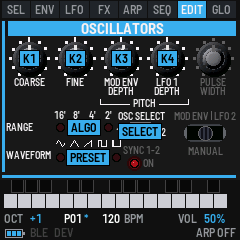

Kept without SAVE, two seconds after a change once the FM-1 is quiet: the four sequences and the patch's (see SEQ), and every GLO
setting (see Global settings). Not saved: AFX
mode (off at each start) and whether the sequencer is playing.

### Backup and restore

A backup is one file on your computer holding everything the FM-1 has saved: the patches, the sequences, Drum Something 400's
patterns and songs, the RND seeds and the settings. It leaves out the panel's calibration and the Bluetooth pairings, which belong
to that FM-1. Make one over USB from the site's Backup page (Chrome or Edge), or from a terminal in fm1-base:

```
python3 tools/fm1_backup.py backup my.bs2 --magic BS2B
python3 tools/fm1_backup.py restore my.bs2
```

**Press SAVE first:** a sound or drums changed but not saved aren't in the backup. The FM-1 can play on while it backs up.

**A restore replaces all of it.** Stop everything first (otherwise the FM-1 says STOP FIRST). It takes in the whole file and checks
it before changing anything, then asks on its screen: RESTORE FROM USB? SEL for yes, HOME for no. A cut cable, a damaged file or
HOME changes nothing. Afterwards it comes up on HOME, as at power-on.

This is apart from SysEx (below), which moves Bass Station II patches to and from editors.

---

## 8. SysEx: a Bass Station II editor

Bass Something 2 reads and writes Novation Bass Station II patch dumps, so a Bass Station II editor or librarian can store
its sounds, and Bass Station II patches (`.syx` files) can play on the FM-1. SysEx goes over the USB cable only.

The website's [SysEx page](https://imijes.github.io/bass-something-2/sysex/) does all of this from Chrome or Edge, with
no other software: it gets the sound or all 128 patches and saves them as a `.syx` file, and sends `.syx` files to the
FM-1 with the pause between messages set for you.

**From the FM-1 to an editor:**

- On GLOBAL DUMP (GLO four times), press SEL: the sound goes out as one dump, with its name (a patch with no name goes
  as Bass Smth 2 and its number, Bass Smth 2 01).
  The screen says SYSEX SENT.
- On GLOBAL DUMP (GLO four times), press FX: all 128 patches go out as a bank, each with its name and addressed to its
  own patch number (0 to 127), as a Bass Station II bank file is. Record them into one `.syx` file
  and it's a backup: sent back, each patch returns to its own slot. The patch you're on goes as it sounds now, with
  changes not yet saved.
- A computer can ask for the sound: SysEx `F0 7D 42 53 32 01 F7` sends the same dump as SEL on GLOBAL DUMP.
  `F0 7D 42 53 32 03 F7` sends the whole bank, as FX on GLOBAL DUMP. `F0 7D 42 53 32 02 F7` sends the RND
  SEED slot's patch to the RND Synth instead (see RND Synth).

**From an editor to the FM-1:** choose the FM-1 as the editor's MIDI output and send the patch (in an editor, it's
usually called Send or Send to synth). Any Bass Station II patch dump works, with a name (firmware 2.5 and later) or
without one. A dump sent as the current sound loads into the sound you're playing now, and the screen says SYSEX
LOADED and the patch's name, which it takes as its own. Press SAVE to keep it in the patch you're on. To keep it in another patch, pick that
patch on the MASTER page first.

**A whole bank:** a Bass Station II bank file (a `.syx` of up to 128 patches, each addressed to its patch number, as
sound packs and librarians save them) loads straight into the FM-1's patches, names and all: patch 0 into P01, 1 into
P02 and on to 127 into 128, so a whole Bass Station II's bank comes over as it is. The screen says BANK IN and the
first one's name, and a second after the last one it saves the bank and says BANK LOADED and how many came in (128
PATCHES for a whole Bass Station II bank). **This replaces the patches it reaches, without SAVE**: send GLOBAL
DUMP's bank to the computer first if you want to keep them. Each patch keeps its own sequence, tempo and gate.

From v0.3 the file can go as fast as the computer sends it: the FM-1 queues the messages and holds the computer back
while it catches up, so none is lost. Firmware before v0.3 took one SysEx message at a time and dropped one that came
while it was still busy with the last: with it, send with a pause between messages (20 ms is enough in testing; 50 ms
leaves room; most librarians, SysEx Librarian on macOS among them, have a setting for it). If BANK LOADED counts fewer
than were sent, send it again with a longer pause.

A dump carries what the two synths share, including both oscillators' tuning, the mod envelope's pulse width depths,
the two velocities, the envelopes' triggering and retriggering, and the filter's key tracking (firmware 2.5's; a dump
from before it tracks fully, as those Bass Station IIs did). It carries the LFOs' speed (all 8 bits), delay, slew, keysync and
sync too, and Osc Filter Mod. It doesn't carry what the FM-1 lacks (paraphonic mode, the oscillator error), or what nobody has yet found the place of in a dump: the envelopes'
retrigger count and fixed sustain (later firmware's), the VCA limiter and the external input's level. Those come in as a Bass Station
II's initial patch has them. The arp's mode (PLAY and REC too), octaves, rhythm and swing come and go with it. The FM-1's own extras (the sequence, the tempo, the gate) stay as
they were when one comes in. Settings the FM-1 doesn't have go out as a Bass Station II's initial patch has them.
Values beyond what an FM-1 control can reach are brought to its nearest.

---

## 9. RND Synth

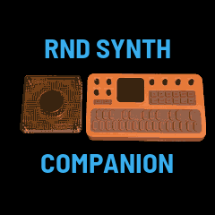

For owners of Cyma Forma's RND Synth (firmware 1.4 or later), Bass Something 2 is its companion and its remote. It
keeps 32 of the RND Synth's patches and sends one back when you want it again, it sets what the RND Synth holds across
new patches (its type, key and tracks), and it mixes the RND Synth's four tracks. None of this changes Bass Something
2's own sound; a new patch's tempo does become the FM-1's (see Tempo below).

**Connecting:** plug the RND Synth and the FM-1 into a computer by USB, and pass MIDI between them both ways (a DAW, or
a MIDI router that passes SysEx). From the RND Synth to the FM-1: its SysEx and its notes. From the FM-1 to the RND
Synth: its SysEx, and its channel messages (a root is set with a note on channel 1, a scale with CC 9 on channel 1,
the tracks' levels and reverb with CCs on channels 2 to 5). If the FM-1's keys also go to the RND Synth, set GLOBAL
MIDI's CHANNEL to something other than 1, or every key you play sets the RND Synth's root.

**Clock:** the RND Synth never sends MIDI clock. It follows the FM-1's (GLOBAL CLOCK's SEND CLK on), or a master
clock that drives both.

Hold GLO for a second for the RND pages, then press GLO for the next one: RND SEED, RND PATCH, RND TRACKS, then
RND SEED again. Hold GLO for a second again to go back to GLOBAL. They use the whole screen under the tabs, in larger print, so
the keys' strip and the status line (octave, patch, volume) are hidden while they're open. They're kept off GLO's own pages, as only RND Synth owners need them.
Opening them asks the RND Synth how it is (its firmware, its patch, its locks, its tracks), and each page shows it.
As they open, a splash fills the screen for a moment: RND SYNTH, the RND Synth beside the FM-1, then COMPANION, in cyan. Any
button or knob skips it.

At the right of each page's own bar is the seed the RND Synth is playing (PLAYING F34E8559; NOT HEARD YET until it
has answered).

### RND SEED: the patches you keep

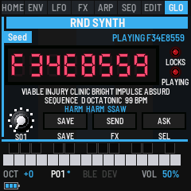

An RND Synth patch is its **seed** (a number, shown as eight digits, F34E8559, that it makes its music from) and its
**locks** (what it held when it rolled the patch). On RND firmware 1.4 the locks are part of the patch: the same seed
with other locks is another patch. Bass Something 2 keeps both, in 32 slots, S01 to S32, through power-off. They're a
table of their own, separate from the 32 patches, so saving a patch or loading a Bass Station II dump doesn't touch
them.

The display shows the slot's seed (dashes: the slot is empty). Beside it, **Locks** lights when the slot's patch holds
locks, and **Playing** when it's the patch the RND Synth is playing now. Under it are the patch's names, the words RND
pixels (Cyma Forma's web app) gives it: three for the seed, then up to three for its locks (VIABLE INJURY CLINIC CODE
INCH ABSURD). Type them into RND pixels to load the same patch there. Under the words: when it's the patch playing,
what the RND Synth says it is (SEQUENCE D OCTATONIC 99 BPM, then each track's engine, in cyan); otherwise what the slot
locks (ANY TYPE ANY ROOT ANY SCALE, then the engines held, - for none).

| Control | What it does |
| --- | --- |
| PRESET · SEED | Picks a slot, S01 to S32. The screen says the slot and its seed (LOCKED: with locks), or EMPTY. |
| SAVE | Keeps the patch the RND Synth is playing, seed and locks, in the slot. The screen says SEED SAVED, the slot and the seed. On this page SAVE doesn't store the FM-1's patch. |
| FX | Sends the slot's patch to the RND Synth: every lock let go, the slot's locks set, then its seed, a step every few milliseconds. The RND Synth plays exactly the patch you kept. The screen says RND SEED SENT. |
| SEL | Asks the RND Synth how it is again, for when it was changed elsewhere (in RND pixels, say). |

**Capturing:** each time the RND Synth makes a new patch, the FM-1 says RND SEED IN, the seed and its tempo
(RND SEED IN 1A2B3C4D 132 BPM), and shows it at the top right. Turn PRESET to a slot and press SAVE to keep it.

**Tempo:** a new patch comes with the RND Synth's tempo for it, and the FM-1 takes it as its TEMPO (40 to 240 BPM).
The arp, the sequencer and SEND CLK's clock follow at once, so when the RND Synth changes direction, the FM-1 moves
with it. If the RND Synth changes its tempo without a new patch, the FM-1 follows that too (RND TEMPO 147 BPM).
Between them TEMPO is yours to turn. Like any TEMPO change it's kept with the sequence after two seconds, once the
FM-1 is quiet (see SEQ).

### RND PATCH: the locks

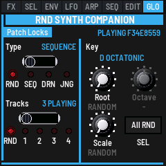

What the RND Synth holds across new patches. Each setting is RND (the RND Synth picks) or a
lock. Locks are kept by the RND Synth, through its button and through power-off. By each group's name, in cyan,
is what the RND Synth is playing now (SEQUENCE, 3 PLAYING, D OCTATONIC).

| Control | What it locks |
| --- | --- |
| SELECT · TYPE | RND, SEQ (sequence), DRN (drone) or JNG (jingles). The RND Synth plays the patch again in the new type at once. |
| ALGO · TRACKS | RND, or 1 to 4 tracks. At once, too. |
| K2 · ROOT | RND, or C to B: the key's tonic, from the next patch. |
| K3 · OCTAVE | The root's octave, −3 to +3. Only with a root locked. |
| K4 · SCALE | RND, or one of 20 scales (Major, Natural Minor, Harmonic Minor, Blues, the pentatonics, the modes, Whole Tone, Double Harmonic, Hungarian Minor, Phrygian Dominant, Hirajoshi, In Sen, Prometheus, Octatonic, Persian), from the next patch. |
| SEL · ALL RND | Lets every lock go, the engines' too. |

Locks change the patch's id: a patch kept after you lock something keeps those locks.

### RND TRACKS: the mixer

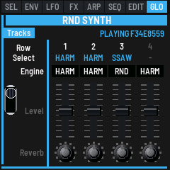

The RND Synth's four tracks, a strip each (K1 to K4), as Env Select picks the ENVELOPES' faders: **Row Select**
(PRESET) picks what K1 to K4 set, and the other rows dim. Each strip shows the track's number and the engine it plays
(in cyan; dim when the track isn't playing).

| Row | K1 to K4 set |
| --- | --- |
| Engine | The engine held on that track: RND, or SUBTR (subtractive), FM, ACID (303), NOISE, SPEECH, PLUCK (plucked string), SSAW (supersaw), HARM (harmonic). On a playing track it changes at once, and the patch is then "off-seed": no seed brings it back exactly. |
| Level | The track's level: the middle is the patch's own (0.0 DB), the top +6 dB, the bottom off. Said in dB. |
| Reverb | The track's reverb send: the middle is the patch's own, the bottom dry, the top as wet as the RND Synth goes. Said in dB. |

Levels and sends go back to the middle with every new patch, as on the RND Synth.

### Playing its tracks

The RND Synth plays its tracks on MIDI channels 1 to 4. Set GLOBAL MIDI CHANNELS' BASS (K2) to one of them, and the FM-1
plays that track's notes with its own sound. On ALL, the four tracks share the FM-1's one voice, each new note cutting
off the last.

### Its messages

The RND Synth's SysEx is `F0 6F 62 78` then a message number: `10` and five 7-bit parts, lowest first, is the seed.
A computer can send it the same way, or have the FM-1 send the RND SEED slot's patch with `F0 7D 42 53 32 02 F7`.

---

## 10. MIDI and audio

MIDI comes in over USB, Bluetooth and the TRS jack. A note on GLO's channel plays the voice (or the arp, or
transposes the sequencer). MIDI clock and start drive the arp and the sequencer (see SYNC). Control changes on GLO's
CC CHAN turn the sound's knobs (see Control changes below). Pitch bend, the mod wheel (CC 1) and aftertouch (channel or
poly) on GLO's channel play the bass as its own wheels and keys' pressure do, as FX's WHEELS and AFTERTOUCH set them
(section 4's mods). They are settings, not a patch's, so every sound shares them. The piano and the drums ignore them. Other messages are shown on the bottom line but change nothing.

The keys go out over USB and Bluetooth: their notes with velocity, and their pressure as poly aftertouch.

### Global settings (GLO)

GLO opens the global settings; press it again for the next page. They belong to the FM-1, not to a patch, and they
save themselves: two seconds after you change one, once the FM-1 is quiet (see SEQ), it's kept through power-off,
without SAVE (so a GLO change never
writes over your patch), and SAVE doesn't light for them. Each page is a GLOBAL panel with its own bar, one subject to a page: MIDI Channels, Connect, Clock, Keys, Audio, Display and
BS2 SysEx Dump. GLOBAL MIDI CHANNELS has a column for each instrument (Bass, Drums, Piano): its CC channel on top, its
note channel under it, each knob's channel printed beneath. A red display shows the main value where a page has one: GLOBAL CLOCK's the tempo (while MIDI clock leads, its tempo as measured over
every two beats; dashes until then) with the clock's state beside it, GLOBAL DUMP's the patch. GLOBAL DISPLAY shows the
firmware's version (VERSION v0.8). The on/off settings are slide switches.

On every GLO page, the right of the page's own bar shows the audio's load (for a moment after a change, what changed
instead), for example **CPU0 34/41**. The first number is the
load now, as a percentage of the time the FM-1 has to make each block of sound. The second is the highest it reached
in the last five seconds. **CPU1** under it is the FM-1's second core, which makes the Piano Something's sound
beside the first (**CPU1 OFF**: one core is doing it all). If the sound ever misses its deadline (a dropout, heard as
a click), a count follows in cyan, for example **CPU0 97/100 !2**, and stays until the FM-1 is switched off. A click without the count going up came
from something else. A write to memory (SAVE, a patch change, and the sequence and GLO settings keeping themselves) holds
up the sound for a moment. In silence nothing is heard and it isn't counted; while something is sounding, it counts.

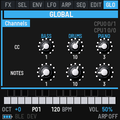
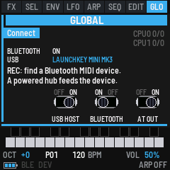
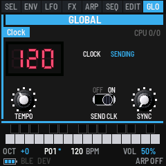
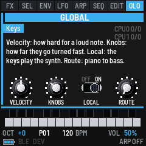
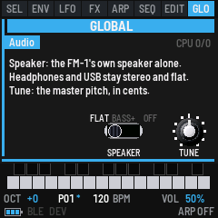
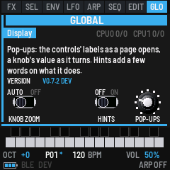
")

Holding GLO for a second opens the RND pages, for the RND Synth: see RND Synth.

| Page | Control | Setting |
| --- | --- | --- |
| MIDI | PRESET CC CHAN (CC CHANNEL) | OFF, 1 to 16 (1 is the default), or ALL. Control changes on that channel turn the sound's knobs (see Control changes). It is separate from CHANNEL, so a controller can use its own channel without playing notes. |
| MIDI | K1 CHANNEL | OFF, 1 to 16 (1 is the default), or ALL. In: notes on that channel play (ALL: any channel; OFF: none). Out: the keys' notes on it (ALL: channel 1; OFF: none). |
| MIDI | K2 LOCAL (LOCAL CONTROL) | ON (the default): the keys play the voice. OFF: they only send MIDI, for a computer that plays it back. The sequencer, the arp from MIDI notes, and MIDI in still play. |
| MIDI | K3 AT OUT (AFTER TOUCH OUT) | The keys' pressure out as poly aftertouch: ON (the default) or OFF. |
| MIDI | K4 BLUETOOTH (BLUETOOTH MIDI) | Bluetooth on (the default) or off, at once. |
| MIDI | REC | Finds and connects a Bluetooth MIDI device (below). |
| CLOCK | K1 TEMPO | The tempo, the same setting as ARP's K1, kept with the patch. While MIDI clock is followed, the knob shows the clock's tempo and turning it changes nothing. |
| CLOCK | K3 SEND CLK (SEND MIDI CLOCK) | ON (the default): MIDI clock goes out at the tempo, and PLAY sends start and stop. Not while following MIDI clock. |
| CLOCK | K4 SYNC (CLOCK SYNC) | What the arp and the sequencer follow. AUTO (the default): MIDI clock while it comes in, else the tempo. INT: the tempo only. EXT: MIDI clock only (without it they wait). While following, a MIDI start begins again from the first step. |
| AUDIO | K3 SPEAKER | The FM-1's speaker, which only ever plays with nothing in the headphone jack. FLAT (the default): as it is. BASS+: the bass the small speaker cannot play, heard through its harmonics. OFF: the speaker silent. Headphones and USB audio stay as they are whatever this is set to: stereo, and with none of BASS+. |
| AUDIO | K4 TUNE | The master tune, −50 to +50 cents (0 is the default). |
| CONTROLS | K3 VELOCITY | The keys' velocity curve: SOFT (louder for a light touch), NORMAL (the default) or HARD. |
| CONTROLS | K4 KNOBS (KNOB RESPONSE) | How far the knobs go as you turn them faster. FINE: always one step a click. NORMAL (the default): up to 8 steps a click on a quick spin. FAST: up to 12, and sooner. COARSE: two steps a click even turned slowly, up to 16. Only the knobs with a wide range (levels, Frequency, Tune, Tempo, the LFOs' speeds and so on); switches and short lists always move one position a click. Drum Something 400's pattern and song numbers and its tempo move one a click when turned slowly, at any of these. |
| DISPLAY | PRESET KNOB ZOOM | AUTO (the default): as you turn an encoder, the panel zooms in on its control (twice the size) and back out a second after you stop; on HOME, a MIDI CC dives in, one camera move: the small panel zooms in on the control's section until it fills the screen, becomes that section's own page and zooms on in to the control, stays while the CCs come, then pulls the same way back out to HOME (a turn of your own while that page is up keeps you there). OFF: no zoom. |
| DISPLAY | K3 HINTS | ON (the default): as you turn a knob, a few words on what it does show under its value; as you press a button, over the keys (a section's button: the page its next tap opens). OFF: none. See The screen. |
| DISPLAY | K4 POP-UPS (POP-UP TIME) | How long the pop-ups stay: the controls' labels as a page opens, a knob's value after you turn it, and the hints. OFF: no labels or button hints, and a value only while the knob turns. 1.5 S (the default), 2 S or 3 S. ALWAYS: until you turn another knob or open another page. |
| DUMP | SEL (Sound) | Sends the sound as one Bass Station II patch dump (SysEx). See SysEx. |
| DUMP | FX (All 32) | Sends all 32 patches as a Bass Station II bank (SysEx), which loads back into the same patches. See SysEx. |
| RND (GLO held) | | The RND Synth's patches, locks and tracks. See RND Synth. |

<a id="cc"></a>
### Control changes

With CC CHAN set, a controller or a Bass Station II editor can turn the sound's knobs over MIDI. The FM-1 uses the
Bass Station II's own CC numbers. Control changes on any other channel, and numbers not in the table, are ignored. A
change marks the patch as edited (SAVE lights up), and it shows on the screen but isn't spoken.

Each value is spread across the knob's range. A knob that goes both ways (such as FINE or an envelope depth) is at
zero at 64. A switch is on at any value above 0. The ranges (16' to 2') take 63 to 66, like a Bass Station II. Other
choices take their number from 0: for example, SUBWAVE takes 0 for SINE, 1 for PULSE and 2 for SQUARE. Where the Bass
Station II uses two CCs for one knob (cutoff 16 and 48, for example), the FM-1 reads the first.

| CC | Page | Knob |
| --- | --- | --- |
| 5 | PORTA | GLIDE TIME |
| 7 | MASTER | the bass's Volume (a setting: SAVE stays dark) |
| 16 | FILTERS | FREQUENCY |
| 17 | FILTERS (its mods) | LFO 2 depth |
| 18 | LFOS | LFO 1 speed |
| 19 | LFOS | LFO 2 speed |
| 20 | SUB OSC + MIXER | OSC1 level |
| 21 | SUB OSC + MIXER | OSC2 level |
| 22 | SUB OSC + MIXER | SUB level |
| 23 | SUB OSC + MIXER | NOISE level |
| 24 | SUB OSC + MIXER | RING level |
| 25 | SUB OSC + MIXER | EXT level |
| 26 | OSCILLATORS (Osc 1) | FINE |
| 27 | OSCILLATORS (Osc 1) | COARSE |
| 28 | OSCILLATORS (Osc 1) | LFO 1 depth |
| 29 | OSCILLATORS (Osc 2) | FINE |
| 30 | OSCILLATORS (Osc 2) | COARSE |
| 31 | OSCILLATORS (Osc 2) | LFO 1 depth |
| 70 | OSCILLATORS (Osc 1) | RANGE |
| 71 | OSCILLATORS (Osc 1) | MOD ENV depth |
| 72 | PULSE WIDTH (Osc 1) | Mod Env |
| 73 | PULSE WIDTH (Osc 1) | LFO 2 |
| 74 | PULSE WIDTH (Osc 1) | Manual |
| 75 | OSCILLATORS (Osc 2) | RANGE |
| 76 | OSCILLATORS (Osc 2) | MOD ENV depth |
| 77 | PULSE WIDTH (Osc 2) | Mod Env |
| 78 | PULSE WIDTH (Osc 2) | LFO 2 |
| 79 | PULSE WIDTH (Osc 2) | Manual |
| 80 | SUB OSC + MIXER | SUBWAVE |
| 81 | SUB OSC + MIXER | OCTAVE |
| 82 | FILTERS | RESONANCE |
| 83 | FILTERS | Type: 0 CLASSIC, 1 ACID |
| 84 | FILTERS | Shape: 0 LP, 1 BP, 2 HP (CLASSIC only) |
| 85 | FILTERS | MOD ENV depth |
| 86 | LFOS | LFO 1 delay |
| 87 | LFOS | LFO 2 delay |
| 88 | LFOS | LFO 1 wave |
| 89 | LFOS | LFO 2 wave |
| 90 to 93 | ENVELOPES (Amp Env) | ATTACK, DECAY, SUSTAIN, RELEASE |
| 94 | EFFECTS | DISTORTION |
| 95 | EFFECTS (its mods) | LIMITER |
| 102 to 105 | ENVELOPES (Mod Env) | ATTACK, DECAY, SUSTAIN, RELEASE |
| 106 | FILTERS | Slope: 0 12, 1 24 (CLASSIC only) |
| 108 | ARP | on or off |
| 109 | ARP | LATCH |
| 110 | OSCILLATORS (the pulse width's view) | SYNC 1-2 |
| 111 | ARP | OCTAVES, K4 (SEQ in PLAY and REC) |
| 112 | ENV MOD (Amp Env) | VELOCITY |
| 113 | ENV MOD (Mod Env) | VELOCITY |
| 114 | FILTERS | OVERDRIVE |
| 115 | EFFECTS | OSC FILTER MOD |
| 116 | ARP MODS | SWING |
| 118 | ARP | MODE, K3 (6 PLAY, 7 REC, as the Bass Station II sends them) |
| 119 | ARP | RHYTHM, K2 |

**Space Something 201:** its knobs and the three instruments' sends into it, on the same channel and on the piano's
CC channel (PIANO CC, GLOBAL MIDI CHANNELS). On the piano's channel the bass's own CCs are left alone, so a controller
there works the echo without touching the patch. They set its settings, not the patch, so SAVE doesn't light. MODE
takes 0 to 11 (11 is REVERB ONLY). BASS, TREBLE and TEMPO SYNC have no CC.

| CC | Knob | CC | Knob |
| --- | --- | --- | --- |
| 3 | MODE | 47 | INPUT |
| 9 | REPEAT RATE | 117 | WOW |
| 14 | INTENSITY | 12 | BASS SEND |
| 15 | ECHO VOLUME | 13 | DRUM SEND |
| 8 | REVERB VOLUME | 107 | PIANO SEND |

**One channel for everything:** no CC number does two things, so the bass, the drums and the piano (and the echo) can
all share one channel, or ALL, and a controller still reaches each on its own. The bass keeps the Bass Station II's
numbers; the others use numbers it leaves free, and MIDI's standard ones where there is one (the sustain pedal, 64).
The drums' tunings (48 to 60) sit on the numbers where a real Bass Station II sends the fine half of a knob, so a Bass
Station II played into the FM-1 on a shared channel can nudge them.

| Instrument | CCs |
| --- | --- |
| Bass | 1, 5, 7, 16 to 31, 70 to 95, 102 to 106, 108 to 116, 118, 119 (the Bass Station II's) |
| Drums | 33 to 37 and 39 to 46 volume, 48 to 60 tuning, 66 roll, 67 roll rate |
| Piano | 11, 61 to 65, 68, 69 |
| Space Echo | 3, 8, 9, 12 to 15, 47, 107, 117 |
| PROX | 4, its target (on the bass's and the piano's CC channels) |

**The RND Synth:** its notes come in on channels 1 to 4. Keep CC CHAN on another channel, or OFF, and its messages
can't change the sound.

### Bluetooth

Bass Something 2 advertises over Bluetooth as "FM-1" and four characters of its own, such as "FM-1 1F2D", so two FM-1s can
be told apart. On a Mac, open Audio MIDI Setup, choose Window > Show MIDI Studio, click the Bluetooth button, then
Connect next to the FM-1. On an iPad or iPhone, connect from a music app's Bluetooth MIDI settings. BLE at the bottom
of the screen lights while connected, and the GLO button pulses slowly while anything is connected over Bluetooth (a
computer, a phone or a device).

To switch Bluetooth off, press GLO twice for GLOBAL CONNECT and turn K3 (BLUETOOTH) to OFF: the FM-1 stops advertising and
drops any connection. Turn it back to ON to switch it on again. It is kept for the next start.

To connect to a Bluetooth MIDI device, such as a keyboard or a controller, put the device in its pairing or
advertising mode, then press GLO twice for GLOBAL CONNECT and press REC: the screen says BLE SCANNING. Turn ALGO to
pick the device by its name, and press REC again to connect. DEV at the bottom lights while it's connected, GLOBAL
CONNECT's Bluetooth line says Connected and its name, and the bottom line shows the last message it sent. Press REC once more (on GLOBAL CONNECT) to disconnect.

### PROX: distance as a knob

PROX turns one knob by how far a Bluetooth MIDI controller or phone is from the FM-1: touching it is the knob's
lowest, arm's length its highest, a sweep between them the knob turning. It reads the strength of the Bluetooth link's
signal, so anything connected works, a device the FM-1 joined (REC, above) first, else a computer or phone. It follows
the controller or phone, not a hand: something passing between them barely moves it, and a shake only blurs it.

On GLOBAL CONNECT (GLO twice), turn PRESET (PROX) to pick the knob, or OFF. It can turn the knobs the motion
recorder records but the drums' volumes, in this order: the bass's FREQUENCY, RESONANCE, ARP RHYTHM and ARP OCTAVES,
each drum's tuning, then the Space Echo's MODE, its three sends, WOW, REVERB VOLUME, ECHO VOLUME, INPUT, INTENSITY
and REPEAT RATE. The Prox line shows the knob
and where PROX has it, 0 to 127, with the signal under it. While it's on, PROX holds that knob: a turn by hand lasts until the controller moves.
PROX's moves are recorded by the motion recorder like a hand's. A controller can pick the target too: CC 4 (MIDI's Foot Controller) on the bass's or the piano's CC channel, in the
list's order, each target a span of its values so a short fader can land on one, the most played wider:

| CC 4 | Target |
| --- | --- |
| 0 to 2 | OFF |
| 3 to 10 | FREQUENCY |
| 11 to 17 | RESONANCE |
| 18 to 20, 21 to 23 | ARP RHYTHM, ARP OCTAVES |
| 24 to 88 | the drums' tunings, 5 each: Bass, Snare, Rim, Tom 1, Tom 2, Crash, Ride, Closed Hat, Open Hat, Claps, Tambourine, Cowbell, Cabasa |
| 89 to 109 | 3 each: MODE, BASS SEND, DRUM SEND, PIANO SEND, WOW, REVERB VOLUME, ECHO VOLUME |
| 110 to 115 | INPUT |
| 116 to 121 | INTENSITY |
| 122 to 127 | REPEAT RATE |

The target and the calibration are kept with the settings, not the patch.

To calibrate it to your controller and your reach, press SEL on GLOBAL CONNECT (PROX SWEEP NEAR TO FAR), sweep the
controller a few times between touching the FM-1 and arm's length, at the speed you'll play it, then press SEL again:
the screen shows the near and far it kept. Sweep rather than hold still: held out at arm's length, a body in the way
reads farther than a sweep ever reaches. Uncalibrated it uses what an SP-1 read: -23 dBm touching, -50 at arm's length.

The signal falls fastest in the first few inches, so PROX squares its reading to give the rest of the reach more of
the knob: with an SP-1, 6 inches out reads about a third up instead of over half. It updates 50 times a second, smoothed over about a tenth of a second close in and a quarter at arm's length (where
the signal moves least and wobbles most), and ignores a change of a single step, so a still hand doesn't make the
knob shimmer. The line under Prox shows the signal now and the near and far it's calibrated to (while calibrating,
the range swept so far). Past about a foot the signal changes only a few dB, so the last stretch to arm's length has
less to work with than the first few inches: if the knob tops out early, calibrate again with full sweeps.

### A USB MIDI keyboard (USB host)

The FM-1's USB port can play host to a USB MIDI keyboard, controller or synth instead of a computer. Press GLO twice for
GLOBAL CONNECT and turn K2 (USB HOST) to ON: the screen says USB HOST LOOKING. Plug the device in, through a powered USB
hub or a powered OTG adapter, and the screen names it (USB DEVICE and its name);
GLOBAL CONNECT shows it beside USB. Its notes, wheels and CCs come in as a computer's would, on the channels of GLOBAL
MIDI CHANNELS, and the FM-1's keys and sequences go out to it. Unplugged, any note it was holding stops (USB DEVICE LOST).

USB host mode gives no USB power: the FM-1 doesn't power the port, so a device that runs from USB power stays dark
plugged straight in. Power it from a powered USB hub, a powered OTG adapter, or its own supply.

While USB HOST is on there is no computer: no USB audio, no MIDI to a computer, no backup and no updates. Turn it OFF
to give the port back to the computer. It is always OFF at power-on, so the computer finds the FM-1 after any restart.

### USB audio

Over the USB cable the FM-1 is also a sound card. A computer can record what it plays (an input named "Bass Something 2 FM-1"),
and can play through it: choose "Bass Something 2 FM-1" as the output, and its sound comes out of the FM-1's speaker and
headphones, mixed with the FM-1's own, at MASTER's volume.

The speaker has one driver, so it plays left and right summed to mono, and a sound panned to either side is not lost. Headphones stay in stereo. The FM-1 knows when something is in the headphone jack, so SPEAKER (GLO AUDIO) only ever changes the speaker.

That output is also the FM-1's Ext input, as the Bass Station II's Ext In socket is: turn the mixer's Ext up (SUB OSC + MIXER,
K3 to Ext, then K4) and the computer's sound goes through the synth instead, into the mixer with the oscillators, then
the filter, the amp envelope and the distortion. Like the Bass Station II's, you hear it only while a note plays (the
amp envelope opens it), so hold a key, use LATCH, or let the arp or the sequencer play the envelope. Its two sides are
mixed into one, as the synth is mono. With Ext at 0 the computer's sound plays straight through, as above.

---

## 11. The screen reader

Bass Something 2 tells a screen reader what's on its screen, through the
[FM-1 Screen Reader](https://charlesvestal.github.io/fm1-reader/): the page, the patch and the settings when the
reader starts listening, then each change as it happens (a knob's whole name and value, SAVED, SYSEX LOADED). The
emulator does the same, with your own screen reader or with its built-in voice.

---

## 12. Troubleshooting

**No sound:** turn MASTER up. Check the mixer's levels on SUB OSC + MIXER (EDIT three times) and the Frequency on the FILTERS (FX); a random sound can be
quiet. On GLOBAL KEYS, LOCAL must be ON for the keys to play.

**A key plays the wrong sound, a different one on each key:** AFX mode is on (AFX at the bottom, left of VOL). Hold ARP or
SEQ for a second to turn it off.

**A note keeps sounding (stuck):** another device sent its note-on but its note-off never arrived. The note's key is
lit: press it and let go, and the note stops. If OCT- or OCT+ is lit instead, the note is out of the keys' reach: press
the lit OCT button. Changing the octave lets every held note go.

**The arp or the sequencer doesn't move:** on GLOBAL CLOCK, SYNC is EXT and no MIDI clock is coming in. Set it to AUTO.

**My change is gone:** picking another patch on the MASTER page drops what wasn't saved. Press SAVE before you move.

**An editor doesn't receive or send dumps:** SysEx goes over USB only. Choose the FM-1 as the editor's MIDI input to
receive and as its MIDI output to send.

**The drums are too loud or too quiet against the synth:** turn the drums' MASTER (K2 on a drum page), or one drum's VOLUME (K3).

**The installer doesn't find the FM-1:** use Chrome or Edge, allow MIDI when asked, and close other programs that use
the FM-1's MIDI port. If it still isn't found, the installer lists the computer's other MIDI ports to try: a Mac can
show the FM-1 under another name.

**The FM-1 doesn't start after an install:** after two failed starts it starts in SAFE MODE, with no sound. Press
PLAY to try the firmware again. If safe mode also fails twice, the FM-1 drops into the chip's own update mode: put the
stock firmware back, then install again. For details, see felucca-bsp's `tools/fm1_rescue.sh`.

**Update mode by hand:** hold REC while you switch the FM-1 on. With m-bootloader installed, that shows its menu.
Without it, REC starts the chip's own update mode, which only the rescue tool can reach.

---

## 13. Credits

Bass Something 2 is by **John Brown** ([@imijes](https://github.com/imijes)), under MPL-2.0. It's built on the work of others:

- **Charles Vestal** ([@charlesvestal](https://github.com/charlesvestal)): fm1-base, the template and platform this
  firmware is built on, and the platform layer of the FM-1 firmwares it comes from.
- **Leo Kuroshita** ([@kurogedelic](https://github.com/kurogedelic), [Hügelton Instruments](https://hugelton.com)):
  Felucca, the firmware fm1-base grew from, and felucca-bsp, which it runs on. Used under MPL-2.0 with his permission.
- **keremimo** ([@keremimo](https://github.com/keremimo)): MIDI clock and transport sync in felucca-bsp.
- **Chris Farrell** ([@seajaysec](https://github.com/seajaysec)): from fm-static, the web installer's finding of an
  FM-1 under any port name, and its package and update checks. Used under MPL-2.0 with his permission.
- **BS2-Web** by François Georgy ([francoisgeorgy/BS2-Web](https://github.com/francoisgeorgy/BS2-Web)): where each
  setting sits in a Bass Station II patch dump, which the SysEx import and export follow.
- **Tronstoner**: the chart of the Bass Station II's arp rhythms (2013, CC BY-SA), the source for rhythms 31 and 32.
- **Quixotic7** ([@Quixotic7](https://github.com/Quixotic7)): RemoteFM1 for iOS and its `.rfm1` format, which runs
  this firmware on an iPhone or iPad.
- **Groove OS** by Peter Gombos: the idea of running FM-1 firmware in the browser (no code from it).
- **Felucca**'s BASS+ by Leo Kuroshita: the name, and the idea of a small speaker suggesting the bass through its
  harmonics, for SPEAKER's (no code from it).
- **RND pixels** by Cyma Forma ([pixels.cymaforma.com](https://pixels.cymaforma.com/)): how an RND Synth patch is
  named (its seed and lock code, and their words), and the RND Synth's SysEx, which the RND pages follow.
- **BIP39**'s English word list (MIT licence, [bitcoin/bips](https://github.com/bitcoin/bips/blob/master/bip-0039/english.txt)):
  the words RND SEED names patches with.
- Fonts: **Barlow** by The Barlow Project Authors and **Terminus** by Dimitar Toshkov Zhekov (both SIL OFL 1.1).

The full list for the platform underneath is fm1-base's `CREDITS.md` and `LICENSING.md`.

Novation and Bass Station are trademarks of Focusrite Audio Engineering Ltd.; M-VAVE and FM-1, Cyma Forma and RND, and
Sequential Circuits and Drumtraks are trademarks of their owners. Bass Something 2 is not affiliated with Novation,
M-VAVE, Cyma Forma or Sequential.
