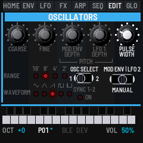
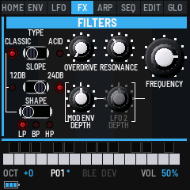
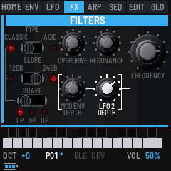
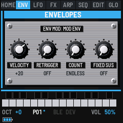
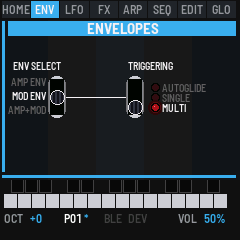
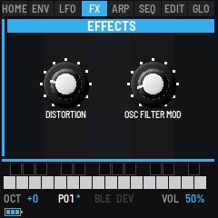
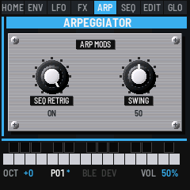

# Bass Something 2

Bass Something 2 turns the M-VAVE FM-1 into a monosynth inspired by the Novation Bass Station II. It has two oscillators
and a sub, a ring modulator and noise. The filter is Classic (low, band or high pass at 24 or 12 dB) or Acid (a
diode ladder), with drive and distortion. It has a mod envelope, an amp envelope, two LFOs, the Bass Station II's 32
arp rhythms with its 32-step sequencer (four sequences) and 32 patches. Patches go to and from a Bass Station II editor as SysEx. Everything
shows on the FM-1's screen as a small Bass Station II front panel, and MIDI goes in and out over USB, Bluetooth and
TRS.

---

## Contents

1. Install
2. The screen
3. Playing
4. The sound
5. The arpeggiator and the sequencer
6. Patches and saving
7. SysEx: a Bass Station II editor
8. RND seeds
9. MIDI and audio
10. The screen reader
11. Troubleshooting
12. Credits

---

## 1. Install

**Try it first:** the emulator runs the same code in the browser, with sound. Play it with the mouse, a touch
screen or the computer keyboard.

**Install from the browser:** in Chrome or Edge, connect the FM-1 by USB, open the installer and press Install.
The browser asks once to allow MIDI: allow it. Don't unplug the cable while it writes.

**Install from a terminal:** `python3 tools/fm1_install.py bass-something-2-VERSION.fwsc`.

**Back to the stock firmware:** the installer's last section writes M-VAVE's own firmware back. An FM-1 that
doesn't start can be recovered too. For details, see felucca-bsp's `tools/fm1_rescue.sh`.

At power-on the screen shows BASS SOMETHING 2 in cyan, "Inspired by the Bass Station 2" under it, and an oscilloscope whose
wave morphs from sine to triangle to saw to a sweeping pulse. The firmware's version (such as v0.1) is in the bottom
right corner. Then the panel opens on the patch you last saved. The emulator shows the same splash when you switch it
on.

---

## 2. The screen

The screen is a small Bass Station II front panel. The pages being rebuilt as its sections (MASTER, OSCILLATORS, MIX FX,
FILTERS, ENVELOPES, PORTA, LFOS and EFFECTS so far, and the mods) are drawn as the panel itself: its blue bar with the section's name, its knobs, switches and red LEDs, the print
white. On these, the panel starts right under the tabs, and a knob shows its value, in cyan, in place of its name while
it turns. The other pages are matte black with dark grey cards, and whatever is live in cyan.

| Part | What it shows |
| --- | --- |
| Section tabs | HOME, ENV, LFO, FX, ARP, SEQ, EDIT and GLO, the buttons. The section you're in has its name in white, the others grey. ARP and SEQ are written in cyan while they play. |
| Title line | The page's name and, while a note plays, its name, its velocity (V) and how hard the key is pressed (P). For a moment after a change, what changed: turning a knob shows its whole name, such as RESONANCE for RESO. |
| Picture | The section's sound: the waves, the filter's curve, the envelope (the stage it's in lit), the LFO (where it is now), the arp's rhythm, the sequencer's steps or the mixer's levels. |
| Switches | What SELECT, ALGO and PRESET set on this page, and their settings. |
| Knobs | K1 to K4: what each sets, its value and a slider. A knob lights cyan for a moment as it turns. |
| Keys | The 27 keys, black above white. A held key fills cyan to its velocity, and white over that shows its pressure. A key whose note is held from MIDI in is all cyan. |
| Bottom lines | OCT, the octave. P01 to P32, the patch, with * while it has changes that aren't saved. BLE, lit while a computer or phone is connected over Bluetooth, and DEV, lit while a Bluetooth MIDI device is. VOL, MASTER's volume. MIDI IN, where the last message came from (USB, BLE or TRS) and its bytes. ARP, SEQ or REC while one of them plays the voice, and AFX while AFX mode is on. |

### The pages

Each section button opens its section's page. Press it again for its next page, where it has more.

| Button | Page | Again |
| --- | --- | --- |
| HOME | MASTER: the patch, picked, saved and sent (the page after the splash) | MIX FX: the sub oscillator and the mixer |
| ENV | ENVELOPES: Env Select (SELECT) and the four faders | TRIGGERING; then the group's mods (velocity, retriggering, fixed sustain) |
| LFO | PORTA and LFOS: the glide, both LFOs' waves and knobs, the Delay/Speed switch | the group's mods (keysync, Speed/Sync, slew) |
| FX | FILTERS | LFO 2 on the filters; then EFFECTS: distortion and Osc Filter Mod; then the group's mods (key tracking, the VCA limiter) |
| ARP | ARPEGGIATOR: tempo, rhythm, mode, octaves, the On and Latch buttons | the group's mods (Seq Retrig, swing), then back |
| SEQ | SEQ: the sequencer | recording on or off (the arp's REC) |
| EDIT | OSCILLATORS: the pitch's view | the pulse width's view |
| GLO | GLOBAL MIDI | GLOBAL SYSTEM, then GLOBAL DUMP |

The buttons' lights: SAVE is lit while there's something to save, ARP while the arp is on, SEQ while recording,
and PLAY while the sequencer plays. The other buttons glow dimly, so they can be found in the dark.

The keys light while their notes are held, whether you're playing them or they come in over MIDI. A note held below
the keys' reach lights OCT-, one above lights OCT+.

---

## 3. Playing

| Control | What it does |
| --- | --- |
| Keys | Play the voice, louder the harder they land. The last key pressed sounds, and the pitch glides to it if GLIDE is up. Each key also goes out as MIDI (see MIDI and audio). |
| OCT− · OCT+ | The octave, from −2 to +2. |
| SEL | On the OSCILLATORS pages, Osc Select: which oscillator their knobs set, 1 or 2. On GLOBAL DUMP, the sound out as a SysEx dump. While the sequencer records, the step's legato (see SEQ). |
| MASTER | The volume. |
| REC | A random sound (see below). On GLOBAL SYSTEM it finds a Bluetooth MIDI device instead. |
| REC + OCT+ | Hold REC and press OCT+: AFX mode on or off. |
| GLO + OCT+ | Hold GLO and press OCT+: GLOBAL RND, for the RND Synth's seeds. See RND seeds. |
| PLAY | Plays the sequence at its own key (the arp on, in PLAY), or stops it. |
| SAVE | Saves the sound into its patch, and the settings. |

The keys sense how hard they're played, with no change to the FM-1. The 20 lowest keys (F3 to C5) give velocity and
pressure; the top seven give velocity only. GLO SYS's VELOCITY sets how the keys answer: SOFT (louder for a light
touch), NORMAL or HARD.

### A random sound

Press REC and let go: the oscillators' waves, oscillator 2's tuning, the sync, the pitches' and pulse widths'
modulation, the widths, the filter (its type, frequency, resonance, overdrive and depths), the glide, the ring and the noise, both envelopes and both LFOs are set at
random. The filter is kept a little open and the attack under a second, so the result is heard at once. The screen
says SOUND RANDOMIZED. Oscillator 1's tuning and the ranges, the mixer's other levels, the arp and the sequencer are
left as they were. Press REC again for another, or SAVE to keep
it.

### AFX mode

Hold REC and press OCT+ to switch AFX mode on. The screen says AFX ON, and AFX stays lit at the bottom right. Each
key then plays the sound with its own changes: oscillator 1's wave, the filter's cutoff, the decay of both envelopes
and the noise. For example, the lowest F is a dark, short sine, like a kick, and some keys add noise for snares and
hi-hats. Each key keeps its changes in any octave, and MIDI notes in play the key they'd be on the keyboard. The
patch itself doesn't change: switch AFX off (REC + OCT+ again) and the keys all play it as before. AFX is off each
time the FM-1 starts.

---

## 4. The sound

The signal goes: oscillators 1 and 2, the sub and noise → the mixer (or the ring modulator) → the filter, with its
drive in front (oscillator 2 moving its cutoff with Osc Filter Mod) → distortion → the amp envelope (the VCA) → the
limiter → MASTER. The mod envelope moves the pitches, the cutoff and the pulse
widths; LFO 1 the pitches, LFO 2 the cutoff and the pulse widths, as on a Bass Station II. Everything on these pages
belongs to the patch, and SAVE keeps it (but not the panels' switches that only pick what a knob sets: Osc Select, the
pulse width's switch, the mixer's).

The envelopes' times are the Bass Station II's: the attack from at once (0) through about 250 ms (64) to 5.5 s (127),
the decay through about 150 ms at the middle to 4.3 s, the release through about 360 ms at the middle to 10.5 s. A
depth of ±63 on an envelope or an LFO moves the cutoff over its whole range, or the pitch by 12 semitones.

Like an analog synth, the engine is never quite still. These behaviours are always on and have no controls:

- **Drift:** each oscillator's pitch wanders slowly by a cent or two, separately from the other one. Even at FINE 0
  the two oscillators beat gently against each other.
- **Free-running oscillators:** a new note doesn't restart the oscillators. Each attack begins somewhere different in
  the wave, so repeated notes vary a little, as they do on the Bass Station II.
- **Supply sag:** loud notes squash slightly, by about 1.5 dB at full velocity. Soft notes are unaffected.
- **Envelope curves:** attacks rise like a charging capacitor, fast at first and then easing into the top, so short
  attacks snap. Decays and releases fall the same way. The times on the knobs are unchanged.
- **Mixer warmth:** the oscillators, sub and noise are summed into a gentle, slightly lopsided saturation before the
  filter, even with DRIVE at 0. Loud peaks round off and stacked waves add a little grit and even harmonics.
- **Filter tolerance and heat:** like two analog units, every FM-1's cutoff sits slightly off the dial, by up to 1 %.
  A note held loud warms the filter over about half a minute, more with high resonance, and its cutoff drifts down by
  up to 2 %. It cools again over a minute or so once you stop.

### OSCILLATORS (EDIT)

The Bass Station II's Oscillators section, with its five knobs, the Range and Waveform LEDs, Osc Select, Sync 1-2 and
the pulse width's switch. The sub oscillator, beside them on a Bass Station II, is on MIX FX. The section has two
views, EDIT and EDIT again: the pitch's and the pulse width's. Each shows the whole section, the controls the
encoders don't set in that view dimmed.

SEL is Osc Select: it switches every knob, the Range and the Waveform between oscillator 1 and oscillator 2.

| Control | Setting |
| --- | --- |
| SELECT · RANGE | The oscillator's footage: 16', 8' (the note played), 4' or 2', its LED lit. |
| ALGO · WAVE | Its wave: sine, triangle, saw, square or pulse, its LED lit. |
| PRESET · SYNC | Sync 1-2: oscillator 2 hard-synced to oscillator 1, its LED lit. Sweep oscillator 2's Coarse or its Mod Env depth for the classic sync sound. |
| K1 · COARSE | The tuning, −12 to +12 semitones. The sub oscillator follows oscillator 1's. |
| K2 · FINE | The fine tuning in cents, −100 to +100. A few cents apart, the two oscillators beat. |
| K3 · MOD ENV | The mod envelope's depth on the pitch, −63 to +63 (12 semitones at full). |
| K4 · LFO 1 | LFO 1's depth on the pitch, −63 to +63 (12 semitones at full). |

#### The pulse width's view (EDIT again)

| Control | Setting |
| --- | --- |
| PRESET · PW SOURCE | The pulse width's switch, as on a Bass Station II: what the Pulse Width knob sets. Manual (the start) is the width, Mod Env the mod envelope's depth on it, LFO 2 LFO 2's. |
| K4 · PULSE WIDTH | Manual: the width, 5 to 95 %. Mod Env and LFO 2: their depth, −63 to +63 (±45 % at full). Each oscillator has its own three; the width counts when its wave is the pulse. |

### FILTERS (FX)

The Bass Station II's Filters section: the Type, Slope and Shape switches (Slope and Shape belong to the Classic
filter: the line from Classic joins them), Overdrive and Resonance, the Mod Env and LFO 2 depths bracketed to the big
Frequency knob. Two views: the filter's (FX) and LFO 2's on it (FX again). Key tracking, a setting on a Bass Station
II, is on the group's mods (FX a fourth time).

| Control | Setting |
| --- | --- |
| SELECT · TYPE | Classic: a ladder filter, low, band or high pass. Acid: a diode ladder's low pass, thinner, with its bass kept under the resonance, like a 303; its Slope and Shape go dark. Back to Classic, it's as it was. |
| ALGO · SLOPE | The Classic filter's slope: 12 or 24 dB an octave. |
| PRESET · SHAPE | The Classic filter's shape: low pass (LP), band pass (BP) or high pass (HP). |
| K1 · OVERDRIVE | Drive into the filter, 0 to 127. |
| K2 · RESONANCE | 0 to 127. Near the top the filter sings on its own, a clean sine at the cutoff. |
| K3 · MOD ENV DEPTH | How far the mod envelope moves the cutoff, −63 to +63 (its whole range at full). |
| K4 · FREQUENCY | The cutoff, 0 to 127: about 40 Hz to 17.8 kHz. |

#### LFO 2's view (FX again)

| Control | Setting |
| --- | --- |
| K1 · LFO 2 DEPTH | How far LFO 2 moves the cutoff, −63 to +63 (its whole range at full). |

### The mods

What Bass Something 2 has that a Bass Station II's panel doesn't, a setting there (its Function and On-Key settings)
or nothing at all, is on its own page: a plate screwed onto the panel, as a modification to a real one would be, brushed metal with Dymo-tape labels.
Each group has its mods as its last page, a press of its button after the others. Its knobs are K1 on.

| Group | Page | Control | Setting |
| --- | --- | --- | --- |
| FX | FX MODS (fourth) | K1 · KEY TRACK | How far the cutoff follows the keys, 0 (not at all) to 7 (fully: an octave higher for each octave up). The cutoff is as set at C3. New patches start at 7, as on a Bass Station II. Patches saved before key tracking start at 0, so they sound as they did. |
| ENV | ENV MOD (third) | SELECT · ENV SELECT | Which envelope the plate sets (its title says): Amp Env, Mod Env, or Amp+Mod (both, the amp's shown). |
| ENV | | K1 · VELOCITY | How much a key's velocity sets it, −63 to +63. The amp envelope's: the volume, at +63 a soft note quiet and a hard one loud, at 0 every note as loud, below 0 reversed. The mod envelope's: its depths (on the pitches, the cutoff and the pulse widths), at +63 a hard note opening the filter further. |
| ENV | | K2 · RETRIGGER | On: the envelope starts again from its attack when its decay ends, a loop while the key is held. |
| ENV | | K3 · COUNT | How many times it retriggers: ENDLESS, or 1 to 16, then it stays in its sustain. |
| ENV | | K4 · FIXED SUS | Fixed-duration sustain, for drums: no decay, the sustain held for the Decay fader's time, then the release, whether the key is held or not. It overrides the retriggering. |
| LFO | LFO MOD (second) | SELECT · LFO | Which LFO the plate sets (its title says): LFO 1 or LFO 2. |
| LFO | | K1 · KEYSYNC | On: a note played on its own starts the LFO from its wave's start, so every note begins the same. |
| LFO | | K2 · SPEED/SYNC | Speed: its knob sets its speed. Sync: its knob sets a sync value instead, the LFO following the tempo. |
| LFO | | K3 · SLEW | 0 to 127: its edges softened, a square gliding from one level to the next (at the top, over about 2 s). |
| FX | | K2 · LIMITER | 0 (off) to 127: the Bass Station II's VCA limiter. The output's level held to a threshold that comes down as it goes up (to 24 dB under full), so a loud, resonant sound is kept in check: more compressed, and quieter. |

New patches start with the amp's velocity at +63 and the mod's at 0, as the FM-1 always played. A Bass Station II
patch brings its own.

The ARP group's mods (SEQ RETRIG and SWING) are with the arpeggiator, in section 5.

### ENVELOPES (ENV)

The Bass Station II's Envelopes section: Env Select and the four faders. Env Select picks which envelope the faders
set, as on a Bass Station II: Amp Env, Mod Env, or Amp+Mod Env, where a fader sets both envelopes to the same place
(and shows the amp's). It only picks what they set: the envelopes play as they are. It's on each of the section's
pages (the triggering and the mods set the envelope it picks too), SELECT moving it; ENV leaves it as it is, going on
to the section's other pages.

| Control | Setting |
| --- | --- |
| SELECT · ENV SELECT | Amp Env, Mod Env or Amp+Mod Env. |
| K1 to K4 | ATTACK, DECAY, SUSTAIN and RELEASE, 0 to 127. |

Each stage moves on from where the last one got to, so a quick retrigger or an early release doesn't click. The
velocities, the retriggering and the fixed sustain are on the group's mods (ENV a third time). The mod envelope's depths are where a Bass Station II has them:
on the pitches on the OSCILLATORS, on the pulse widths on their view, on the cutoff on the FILTERS.

#### TRIGGERING (ENV again)

The Bass Station II's Triggering switch, for the envelope Env Select picks (each envelope has its own, kept with the
patch; Amp+Mod sets both):

| Control | Setting |
| --- | --- |
| SELECT · ENV SELECT | Amp Env, Mod Env or Amp+Mod Env. |
| ALGO · TRIGGER | Multi: every note starts the envelope again, legato or not. Single: a note played on its own starts it; a note played legato (another key still held) doesn't, the envelope going on. Autoglide: as Single, and the glide is on legato notes only, a note on its own going straight to its pitch (either envelope at Autoglide does this). With Multi and Single the glide is on every note. New patches start at Multi. |

The arp's and the sequencer's notes each start the envelopes as their own notes (the sequencer's legato steps don't).

### PORTA and LFOS (LFO)

The Bass Station II's Porta and LFOs sections, side by side as on its panel. Each LFO has its wave button (four LEDs:
triangle, falling saw, square, sample and hold; the lit one blinks with the LFO) and one knob, which the Delay/Speed
switch sets: its speed or its delay. Under each knob is what it sets now.

| Control | Setting |
| --- | --- |
| SELECT · GLIDE TIME | PORTA's portamento: 0 jumps to each note; 1 to 127 glides, from 3 ms to 2.5 s. |
| ALGO · DELAY/SPEED | The switch: Speed (down) or Delay (up), for both knobs. It only picks what they set: both settings are kept. |
| K1 · WAVE 1 | LFO 1's wave: triangle, saw (falling, as the Bass Station II's), square or S&H (a new random level each cycle). |
| K2 · LFO 1 | At Speed, its speed, 0 to 255 as the Bass Station II's (about 0.2 Hz to 190 Hz: 3 Hz at 52, 7.9 Hz at 75; shown in Hz); with Speed/Sync at Sync (the mods), its sync value instead, a cycle from 64 beats (64b) to a 32nd-note triplet (32t), as the Bass Station II's display shows them. At Delay, its fade-in from a note, 0 (none) to 127. |
| K3 · LFO 2 | The same for LFO 2. |
| K4 · WAVE 2 | LFO 2's wave, the same. |

Synced, an LFO follows the tempo, or MIDI clock when it's followed (GLOBAL MIDI's CLOCK). A note played on its own
starts the delay's fade-in and, with keysync, the wave from its start; a note played legato doesn't. New patches start
as the Bass Station II's INIT PATCH: LFO 1 at 75 (7.9 Hz), LFO 2 at 52 (3 Hz) with keysync.

As on a Bass Station II, where each LFO goes is fixed, and its depths are set where it goes: LFO 1 moves the
oscillators' pitches (the OSCILLATORS' LFO 1 depth, one for each oscillator), LFO 2 the cutoff (the FILTERS' LFO 2
depth) and the pulse widths (the pulse width's switch at LFO 2).

Patches saved before this version had each LFO on a destination of its own. They're converted: an LFO 1 on the
pitch is on both oscillators, one on oscillator 2 on that one, and an LFO 2 on the cutoff is on the filter. An LFO 1
on the cutoff, or an LFO 2 on the pitch, has no place on a Bass Station II and is set to 0. A sine LFO (Bass Station
II LFOs have none) becomes a triangle.

### MIX FX (HOME again)

The page is laid out as that part of the Bass Station II's panel: the end of the oscillators' section, the Sub Osc with
its octave and wave switches (a red LED at what each is set to), then the MIXER, its four knobs with the switch that
picks what the fourth one sets. It starts right under the tabs, with no row for the page's name, so a knob's name
changes to its value, in cyan, while it turns.

| Control | Setting |
| --- | --- |
| SELECT · OCTAVE | The sub oscillator's octave, −1 or −2 below oscillator 1. |
| ALGO · SUBWAVE | The sub oscillator's wave: sine, narrow pulse or square. |
| PRESET · SUB | The sub's level, 0 to 127 (the mixer's Sub Osc knob). |
| K1 · OSC1 | Oscillator 1's level, 0 to 127. |
| K2 · OSC2 | Oscillator 2's level. |
| K3 · SOURCE | The mixer's switch: what K4 sets, Noise, Ring or Ext. It isn't saved with the patch, like the switch on a Bass Station II. |
| K4 · Noise, Ring or Ext | The level the switch picks: the noise or the ring modulator (both kept by the patch), or Ext: the computer's sound over USB, through the filter and the amp (see USB audio in [section 9](#s9)). Ext is saved with the patch. |

### EFFECTS (FX a third time)

The Bass Station II's Effects section.

| Control | Setting |
| --- | --- |
| K1 · DISTORTION | 0 (none) to 127, made up so it stays about as loud. As on a Bass Station II it comes before the VCA, so its character doesn't change as the amp envelope fades. |
| K2 · OSC FILTER MOD | 0 (off) to 127: oscillator 2 moves the filter's frequency directly, at audio rate, up to 3 octaves either way at full. What it does depends on everything about oscillator 2 (its range, pitch, wave, pulse width and modulation) but not its level in the mixer: try it while sweeping oscillator 2's tuning. |

---

## 5. The arpeggiator and the sequencer

As on the Bass Station II, the sequencer is part of the arpeggiator. The arp's MODE has the Bass Station II's eight
positions: six arp modes, then PLAY and REC for the sequencer. Both play in the arp's RHYTHM, at its TEMPO and SWING,
or to MIDI clock when it comes in (see GLO MIDI's CLOCK).

### ARP

Press ARP to open its page. As on the Bass Station II's panel, the arp has its On and Latch buttons: turn SELECT up
to switch it on (the LED beside ON lights, and so does ARP), down to switch it off. While it's on, the notes you hold are played one
at a time over the octaves you set and in the rhythm you pick. It holds up to 16 notes, from the keys and from MIDI
in.

| Control | Setting |
| --- | --- |
| SELECT · ON | The arp on (turn up) or off (turn down). While the sequencer records, it's LEGATO instead (see SEQ). |
| ALGO · LATCH | Turn up for on (the LED beside LATCH lights): the notes keep playing after you let go, until you play a new chord, which replaces them. With the arp off, LATCH is the Bass Station II's key hold: the last note you played keeps sounding until you play another. While the sequencer records, it's REST instead. |
| K1 · TEMPO | 40 to 240 BPM. |
| K2 · RHYTHM | The Bass Station II's 32 arp rhythms. Each is two bars of 16ths with rests and held notes. Rhythm 1 is two bars of quarter notes, and 32 plays every 16th. |
| K3 · MODE (ARP MODE) | UP, DOWN, UP/DN (the top and bottom notes once each), UP/DN2 (twice each), PLAYED (in the order played), RANDOM, PLAY (the sequencer plays) or REC (the sequencer records), named around the knob as on the panel. |
| K4 · OCTAVES | A four-position switch, 1 to 4 octaves, its positions on its left as on the panel. In PLAY and REC it's SEQ instead: which of the four sequences, as on the Bass Station II's switch. |

Press ARP again for the group's mods, two Bass Station II settings that aren't on its panel, and once more to come
back.

| Control | Setting |
| --- | --- |
| K1 · SEQ RETRIG | ON: the arp's notes, or the sequence, start again from the first every two bars, at the start of the rhythm. OFF: they run on across it. |
| K2 · SWING (ARP SWING) | 3 to 97 %. 50 is straight. Above it, the first 16th of each pair is longer and the second shorter. Below it, the reverse. |

### SEQ

The sequencer plays a recorded sequence of up to 32 steps. Each step is a note or a rest, and a note can be legato.
The steps have no length of their own: **the arp's rhythm gives the timing**. Each note in the rhythm plays the next
step, its held 16ths hold the step on, and its rests are silent. The same sequence sounds different on every
rhythm, and SWING swings it.

Four sequences are kept, as on the Bass Station II. OCTAVES picks one in PLAY and REC (SEQ on this page does the
same). Each patch also holds a copy of the one it was saved with, so a patch brings its sequence back with it.

**Playing it:** with the arp on and in PLAY, hold a key. The sequence plays transposed from its first note, so the
key of that note plays it as it was recorded and each key above or below moves it by that many semitones. With
LATCH it plays on after you let go, and a new key transposes it. **PLAY** does this in one press: it switches the
arp on in PLAY and plays the sequence at its own key, and PLAY again stops it (and switches the arp off). A key
pressed while it plays transposes it.

**The length and the rhythm:** a sequence is as long as the number of steps recorded, and a rhythm is 8 to 32 notes
long, so they often differ. With SEQ RETRIG ON, the sequence starts again from its first step every two bars, even if it
hasn't finished. With SEQ RETRIG OFF, it plays all the way through and wraps around the rhythm. An 8-step sequence on a
16-note rhythm plays twice in the two bars. That's how a short sequence fills a longer pattern, as on the Bass
Station II: the sequencer has no empty steps to fill.

**Recording:** on the SEQ page, press SEQ again (MODE goes to REC, and SEQ and REC light). The first note you play
starts a new sequence from step 1. Each key, or each note from MIDI in, is the next step, and the screen shows it
(STEP 3 G3). The keys play the voice as you go.

| Button | While recording |
| --- | --- |
| FX, or ALGO turned up on the ARP page | A rest (the Bass Station II's REST). |
| SEL, or SELECT turned up on the ARP page | Makes the step just recorded legato (the Bass Station II's LEGATO). That note is held into the next one, which plays without a new attack. The same note on both sides makes a tie: one note held over both steps. Again cancels it. A rest can't be tied. |

Recording stops at 32 steps (SEQ FULL). Press SEQ again to stop: MODE goes to PLAY. Leaving REC before playing a note
keeps the sequence as it was.

| Control | Setting |
| --- | --- |
| SELECT · SEQ (SEQUENCE) | Which of the four sequences: turning it loads that one into the patch. |
| ALGO · LENGTH (SEQ LENGTH) | The steps that play, 0 to 32. Lengthen it and the steps after the old length come back as they were last recorded (rests on a new sequence). |
| PRESET · STEP | The cursor: which step K1 and K2 edit (white in the picture). |
| K1 · NOTE | The step's note, from REST up through the notes. |
| K2 · LEGATO | The step's legato, ON or OFF. |
| K3 · GATE | How long each note sounds, 5 to 100 % of its 16th (an FM-1 extra; the arp's notes too). |
| K4 · RHYTHM | The arp's rhythm, the same as ARP's K2: the sequence plays in it. (TEMPO is on the ARP page.) |

The plate's display shows the rhythm as a row of lights over the 32 steps: a lit light is a 16th that plays a note.
Under it each step is a bar, its height the note's pitch, a legato note joined to the next. A mark under the bars
shows the step playing, and the cursor's step is white. Steps past the length are dark.

**The sequences are kept by themselves:** two seconds after you last change one, once the FM-1 is quiet, the four
sequences and the patch's copy are written to memory (with which of the four it plays, the gate, the tempo and the
swing), so they're still there after power-off without SAVE. Turning PRESET to another patch keeps them first. The
rest of the sound still needs SAVE.

Writing to the FM-1's memory stops the sound for a moment, so it waits for silence: the sequencer stopped, the arp
with no notes, no key held and the last note faded out, for half a second. Change TEMPO while the sequence plays and
it's kept when you stop it. Switch off while it's still playing and those changes are lost: stop first. SAVE and
turning PRESET write at once, so pressing SAVE mid-performance gives a short gap.

---

## 6. Patches and saving

Bass Something 2 holds 32 patches, P01 to P32. Each patch is a complete sound: the settings of every control described
in [section 4](#s4), plus the arp and the sequence.

A new Bass Something 2 starts with 32 factory patches, GHOST MACHINE I in P01 to DATA RAIN in P32. They are the first 32
of the ULTIMATE PATCHES Volume 2 bank for the Bass Station II (see [Credits](#s12)), each with the default sequence.
Updating the firmware keeps the patches you have. To get the factory ones back, send the factory bank,
`bs2/presets/factory.syx` in the source (see [SysEx](#s7)).

The MASTER page (HOME) is the Bass Station II's Master section, and the page Bass Something 2 starts on: the Volume
(the FM-1's MASTER knob, as it's set), the display with the patch in red, its dot lit while there are changes not
saved, the Save button and the Patch buttons.

| Control | What it does |
| --- | --- |
| PRESET | The Patch buttons: picks a patch, P01 to P32, and plays it at once; the button the way you turned lights. Changes you haven't saved to the patch you leave are lost. An arp or a sequence that is playing keeps playing, in the new sound. |
| SAVE | Stores the sound into the patch shown. |
| SEL | Nothing here. The sound goes out as a SysEx dump from GLOBAL DUMP (see SysEx). |

**SAVE** works on every page but GLOBAL RND (where it keeps a seed). It stores the sound into its patch and keeps the
settings: the octave and the patch you're on (the FM-1 starts on it next time). While something isn't saved, SAVE is
lit and the patch shows * at the bottom of the screen (P01*). The screen says SAVED and the
patch's number when it's done.

Kept without SAVE, two seconds after a change once the FM-1 is quiet: the four sequences and the patch's (see SEQ), and every GLO
setting (see Global settings). Not saved: AFX
mode (off at each start) and whether the sequencer is playing.

---

## 7. SysEx: a Bass Station II editor

Bass Something 2 reads and writes Novation Bass Station II patch dumps, so a Bass Station II editor or librarian can store
its sounds, and Bass Station II patches (`.syx` files) can play on the FM-1. SysEx goes over the USB cable only.

**From the FM-1 to an editor:**

- On GLOBAL DUMP (GLO three times), press SEL: the sound goes out as one dump, named Bass Smth 2 and its number (Bass Smth 2 01: a patch name holds 16 characters).
  The screen says SYSEX SENT.
- On GLOBAL DUMP (GLO three times), press FX: all 32 patches go out as a bank, Bass Smth 2 01 to Bass Smth 2 32, each
  addressed to its own patch number (0 to 31), as a Bass Station II bank file is. Record them into one `.syx` file
  and it's a backup: sent back, each patch returns to its own slot. The patch you're on goes as it sounds now, with
  changes not yet saved.
- A computer can ask for the sound: SysEx `F0 7D 42 53 32 01 F7` sends the same dump as SEL on GLOBAL DUMP.
  `F0 7D 42 53 32 03 F7` sends the whole bank, as FX on GLOBAL DUMP. `F0 7D 42 53 32 02 F7` asks for the RND seed
  shown instead (see RND seeds).

**From an editor to the FM-1:** choose the FM-1 as the editor's MIDI output and send the patch (in an editor, it's
usually called Send or Send to synth). Any Bass Station II patch dump works, with a name (firmware 2.5 and later) or
without one. A dump sent as the current sound loads into the sound you're playing now, and the screen says SYSEX
LOADED and the patch's name. Press SAVE to keep it in the patch you're on. To keep it in another patch, pick that
patch on the MASTER page first.

**A whole bank:** a Bass Station II bank file (a `.syx` of up to 128 patches, each addressed to its patch number, as
sound packs and librarians save them) loads straight into the FM-1's patches: patch 0 into P01, 1 into P02 and on to
31 into P32. The FM-1 has 32 patches, so the rest of a 128-patch bank is left out. The screen says BANK IN and the
first one's name, and a second after the last one it saves the bank and says BANK LOADED and how many came in (32
IN, 96 LEFT for a whole Bass Station II bank). **This replaces the patches it reaches, without SAVE**: send GLOBAL
DUMP's bank to the computer first if you want to keep them. Each patch keeps its own sequence, tempo and gate.

Send the file with a pause between messages: the FM-1 takes one SysEx message at a time and drops one that comes
while it's still busy with the last. 20 ms is enough in testing; 50 ms leaves room. Most librarians (SysEx Librarian on
macOS among them) have a setting for the delay between messages. If BANK LOADED counts fewer than were sent, send it
again with a longer pause.

A dump carries what the two synths share, including both oscillators' tuning, the mod envelope's pulse width depths,
the two velocities, the envelopes' triggering and retriggering, and the filter's key tracking (firmware 2.5's; a dump
from before it tracks fully, as those Bass Station IIs did). It carries the LFOs' speed (all 8 bits), delay, slew, keysync and
sync too, and Osc Filter Mod. It doesn't carry what the FM-1 lacks (paraphonic mode, the oscillator error), or what nobody has yet found the place of in a dump: the envelopes'
retrigger count and fixed sustain (later firmware's), the VCA limiter and the external input's level. Those come in as a Bass Station
II's initial patch has them. The arp's mode (PLAY and REC too), octaves, rhythm and swing come and go with it. The FM-1's own extras (the sequence, the tempo, the gate) stay as
they were when one comes in. Settings the FM-1 doesn't have go out as a Bass Station II's initial patch has them.
Values beyond what an FM-1 control can reach are brought to its nearest.

---

## 8. RND seeds

For owners of Cyma Forma's RND Synth, Bass Something 2 can be its companion: it captures the RND Synth's seeds, keeps 32 of
them, and sends one back when you want it again. A seed is the number, shown as eight digits (12345678), that the RND
Synth makes its music from. Seeds don't change Bass Something 2's own sound; a new seed's tempo does become the FM-1's
(see Tempo).

The seeds are kept in a table of their own, S01 to S32, through power-off. It's separate from the 32 patches, so
saving a patch or loading a Bass Station II dump doesn't touch it.

Hold GLO and press OCT+ for GLOBAL RND. It's kept off GLO's own pages, as only RND Synth owners need it;
press GLO to leave it. The card shows the seed in cyan, and under it FROM RND (the RND Synth's latest)
or FROM SLOT (a kept one), and SAVED when it's the one kept in the slot shown.

| Control | What it does |
| --- | --- |
| PRESET · SEED | Picks a slot, S01 to S32, and shows its seed. An empty slot says EMPTY and leaves the seed shown as it was, ready to keep there. |
| SAVE | Keeps the seed shown in the slot shown. The screen says SEED SAVED, the slot and the seed. On this page SAVE doesn't store the patch. |
| FX | Sends the seed shown to the RND Synth, over USB. The screen says RND SEED SENT. |

**Connecting:** plug the RND Synth and the FM-1 into a computer by USB, and pass MIDI between them (a DAW, or a MIDI
router that passes SysEx). From the RND Synth to the FM-1: its seeds and its notes. From the FM-1 to the RND Synth:
the seeds it sends.

**Capturing:** each time the RND Synth makes a new seed, the FM-1 says RND SEED IN, the seed and its tempo
(RND SEED IN 1A2B3C4D 132 BPM). Turn PRESET to an empty slot and press SAVE to keep it. The RND Synth repeats its seed
often; only a new one is taken. Its other messages (the key and the scale, its tracks) are accepted and left alone.

**Tempo:** a new seed comes with the RND Synth's tempo for it, and the FM-1 takes it as its TEMPO (40 to 240 BPM).
The arp, the sequencer and CLK OUT's clock follow at once, so when the RND Synth changes direction, the FM-1 moves
with it. If the RND Synth changes its tempo without a new seed, the FM-1 follows that too (RND TEMPO 147 BPM).
Between them TEMPO is yours to turn: the RND Synth repeating the same tempo doesn't set it back. Like any TEMPO
change it's kept with the sequence after two seconds, once the FM-1 is quiet (see SEQ).

**Sending one back:** turn PRESET to the slot and press FX.

**Playing its tracks:** the RND Synth plays its four tracks on MIDI channels 1 to 4. Set GLOBAL MIDI's CHANNEL (K1) to
one of them, and the FM-1 plays that track's notes with its own sound. On ALL, the four tracks share the FM-1's one
voice, each new note cutting off the last.

The seed message is `F0 6F 62 78 10 c0 c1 c2 c3 c4 F7`: the seed in five 7-bit parts, lowest first. A computer can
send it the same way, or ask for the seed shown with `F0 7D 42 53 32 02 F7`.

---

## 9. MIDI and audio

MIDI comes in over USB, Bluetooth and the TRS jack. A note on GLO's channel plays the voice (or the arp, or
transposes the sequencer). MIDI clock and start drive the arp and the sequencer (see CLOCK). Control changes on GLO's
CC CHAN turn the sound's knobs (see Control changes below). Other messages, such as pitch bend, are shown on the bottom
line but change nothing.

The keys go out over USB and Bluetooth: their notes with velocity, and their pressure as poly aftertouch.

### Global settings (GLO)

GLO opens the global settings; press it again for the next page. They belong to the FM-1, not to a patch, and they
save themselves: two seconds after you change one, once the FM-1 is quiet (see SEQ), it's kept through power-off,
without SAVE (so a GLO change never
writes over your patch), and SAVE doesn't light for them. GLOBAL SYSTEM's card also shows the tempo's source, Bluetooth's state, and
the firmware with its version (FIRMWARE BASS SOMETHING 2 v0.1).

On every GLO page, the top right corner shows the audio's load, for example **CPU 34/41**. The first number is the
load now, as a percentage of the time the FM-1 has to make each block of sound. The second is the highest it reached
in the last five seconds. If the sound ever misses its deadline (a dropout, heard as a click), a count follows in
blue, for example **CPU 97/100 !2**, and stays until the FM-1 is switched off. A click without the count going up came
from something else. Every write to memory (SAVE, a patch change, and the sequence and GLO settings keeping
themselves) also adds one, because the write holds up the sound for a moment. When those happen in silence, nothing
is heard.

GLO + OCT+ (hold GLO, press OCT+) opens one more page, GLOBAL RND, for the RND Synth's seeds: see RND seeds.

| Page | Control | Setting |
| --- | --- | --- |
| MIDI | SELECT CC CHAN (CC CHANNEL) | OFF (the default), 1 to 16, or ALL. Control changes on that channel turn the sound's knobs (see Control changes). It is separate from CHANNEL, so a controller can use its own channel without playing notes. |
| MIDI | K1 CHANNEL | OFF, 1 to 16, or ALL (the default). In: notes on that channel play (ALL: any channel; OFF: none). Out: the keys' notes on it (ALL: channel 1; OFF: none). |
| MIDI | K2 LOCAL (LOCAL CONTROL) | ON: the keys play the voice. OFF: they only send MIDI, for a computer that plays it back. The sequencer, the arp from MIDI notes, and MIDI in still play. |
| MIDI | K3 AT OUT (AFTER TOUCH OUT) | The keys' pressure out as poly aftertouch: ON or OFF. |
| MIDI | K4 CLOCK (ARP/SEQ CLOCK) | What the arp and the sequencer follow. AUTO: MIDI clock while it comes in, else the tempo. INT: the tempo only. EXT: MIDI clock only (without it they wait). While following, a MIDI start begins again from the first step. |
| SYS | K1 TUNE | The master tune, −50 to +50 cents. |
| SYS | K2 CLK OUT (MIDI CLOCK OUT) | ON: MIDI clock goes out at the tempo, and PLAY sends start and stop. Not while following MIDI clock. |
| SYS | K3 VELOCITY | The keys' velocity curve: SOFT (louder for a light touch), NORMAL or HARD. |
| SYS | K4 BLE (BLUETOOTH MIDI) | Bluetooth on or off, at once. |
| SYS | REC | Finds and connects a Bluetooth MIDI device (below). |
| DUMP | FX | Sends all 32 patches as a Bass Station II bank (SysEx), which loads back into the same patches. See SysEx. |
| RND (GLO + OCT+) | PRESET, SAVE, FX | Picks, keeps and sends the RND Synth's seeds. See RND seeds. |

### Control changes

With CC CHAN set, a controller or a Bass Station II editor can turn the sound's knobs over MIDI. The FM-1 uses the
Bass Station II's own CC numbers. Control changes on any other channel, and numbers not in the table, are ignored. A
change marks the patch as edited (SAVE lights up), and it shows on the screen but isn't spoken.

Each value is spread across the knob's range. A knob that goes both ways (such as FINE or an envelope depth) is at
zero at 64. A switch is on at any value above 0. The ranges (16' to 2') take 63 to 66, like a Bass Station II. Other
choices take their number from 0: for example, SUBWAVE takes 0 for SINE, 1 for PULSE and 2 for SQUARE. Where the Bass
Station II uses two CCs for one knob (cutoff 16 and 48, for example), the FM-1 reads the first.

| CC | Page | Knob |
| --- | --- | --- |
| 5 | PORTA | GLIDE TIME |
| 16 | FILTERS | FREQUENCY |
| 18 | LFOS | LFO 1 speed |
| 19 | LFOS | LFO 2 speed |
| 20 | MIX FX | OSC1 level |
| 21 | MIX FX | OSC2 level |
| 22 | MIX FX | SUB level |
| 23 | MIX FX | NOISE level |
| 24 | MIX FX | RING level |
| 26 | OSCILLATORS (Osc 1) | FINE |
| 27 | OSCILLATORS (Osc 1) | COARSE |
| 29 | OSCILLATORS (Osc 2) | FINE |
| 30 | OSCILLATORS (Osc 2) | COARSE |
| 70 | OSCILLATORS (Osc 1) | RANGE |
| 71 | OSCILLATORS (Osc 1) | MOD ENV depth |
| 72 | PULSE WIDTH (Osc 1) | Mod Env |
| 73 | PULSE WIDTH (Osc 1) | LFO 2 |
| 74 | PULSE WIDTH (Osc 1) | Manual |
| 75 | OSCILLATORS (Osc 2) | RANGE |
| 76 | OSCILLATORS (Osc 2) | MOD ENV depth |
| 77 | PULSE WIDTH (Osc 2) | Mod Env |
| 78 | PULSE WIDTH (Osc 2) | LFO 2 |
| 79 | PULSE WIDTH (Osc 2) | Manual |
| 80 | MIX FX | SUBWAVE |
| 82 | FILTERS | RESONANCE |
| 85 | FILTERS | MOD ENV depth |
| 86 | LFOS | LFO 1 delay |
| 87 | LFOS | LFO 2 delay |
| 88 | LFOS | LFO 1 wave |
| 89 | LFOS | LFO 2 wave |
| 90 to 93 | ENVELOPES (Amp Env) | ATTACK, DECAY, SUSTAIN, RELEASE |
| 94 | EFFECTS | DISTORTION |
| 102 to 105 | ENVELOPES (Mod Env) | ATTACK, DECAY, SUSTAIN, RELEASE |
| 108 | ARP | on or off |
| 109 | ARP | LATCH |
| 110 | OSCILLATORS | SYNC 1-2 |
| 111 | ARP | OCTAVES, K4 (SEQ in PLAY and REC) |
| 112 | ENV MOD (Amp Env) | VELOCITY |
| 113 | ENV MOD (Mod Env) | VELOCITY |
| 114 | FILTERS | OVERDRIVE |
| 115 | EFFECTS | OSC FILTER MOD |
| 116 | ARP MODS | SWING |
| 118 | ARP | MODE, K3 (6 PLAY, 7 REC, as the Bass Station II sends them) |
| 119 | ARP | RHYTHM, K2 |

**The RND Synth:** its notes come in on channels 1 to 4. Keep CC CHAN on another channel, or OFF, and its messages
can't change the sound.

### Bluetooth

Bass Something 2 advertises over Bluetooth as "FM-1" and four characters of its own, such as "FM-1 1F2D", so two FM-1s can
be told apart. On a Mac, open Audio MIDI Setup, choose Window > Show MIDI Studio, click the Bluetooth button, then
Connect next to the FM-1. On an iPad or iPhone, connect from a music app's Bluetooth MIDI settings. BLE at the bottom
of the screen lights while connected.

To switch Bluetooth off, press GLO until GLOBAL SYSTEM shows and turn K4 (BLE) to OFF: the FM-1 stops advertising and
drops any connection. Turn it back to ON to switch it on again. Press SAVE to keep the choice for the next start.

To connect to a Bluetooth MIDI device, such as a keyboard or a controller, put the device in its pairing or
advertising mode, then press GLO until GLOBAL SYSTEM shows and press REC: the screen says BLE SCANNING. Turn ALGO to
pick the device by its name, and press REC again to connect. DEV at the bottom lights while it's connected, and the
bottom line shows the last message it sent. Press REC once more (on GLOBAL SYSTEM) to disconnect.

### USB audio

Over the USB cable the FM-1 is also a sound card. A computer can record what it plays (an input named "Bass Something 2 FM-1"),
and can play through it: choose "Bass Something 2 FM-1" as the output, and its sound comes out of the FM-1's speaker and
headphones, mixed with the FM-1's own, at MASTER's volume.

That output is also the FM-1's Ext input, as the Bass Station II's Ext In socket is: turn the mixer's Ext up (MIX FX,
K3 to Ext, then K4) and the computer's sound goes through the synth instead, into the mixer with the oscillators, then
the filter, the amp envelope and the distortion. Like the Bass Station II's, you hear it only while a note plays (the
amp envelope opens it), so hold a key, use LATCH, or let the arp or the sequencer play the envelope. Its two sides are
mixed into one, as the synth is mono. With Ext at 0 the computer's sound plays straight through, as above.

---

## 10. The screen reader

Bass Something 2 tells a screen reader what's on its screen, through the
[FM-1 Screen Reader](https://charlesvestal.github.io/fm1-reader/): the page, the patch and the settings when the
reader starts listening, then each change as it happens (a knob's whole name and value, SAVED, SYSEX LOADED). The
emulator does the same, with your own screen reader or with its built-in voice.

---

## 11. Troubleshooting

**No sound:** turn MASTER up. Check the mixer's levels on MIX FX (HOME twice) and the Frequency on the FILTERS (FX); a random sound can be
quiet. On GLOBAL MIDI, LOCAL must be ON for the keys to play.

**A key plays the wrong sound, a different one on each key:** AFX mode is on (AFX at the bottom right). Hold REC and
press OCT+.

**A note keeps sounding (stuck):** another device sent its note-on but its note-off never arrived. The note's key is
lit: press it and let go, and the note stops. If OCT- or OCT+ is lit instead, the note is out of the keys' reach: press
the lit OCT button. Changing the octave lets every held note go.

**The arp or the sequencer doesn't move:** on GLOBAL MIDI, CLOCK is EXT and no MIDI clock is coming in. Set it to AUTO.

**My change is gone:** picking another patch on the MASTER page drops what wasn't saved. Press SAVE before you move.

**An editor doesn't receive or send dumps:** SysEx goes over USB only. Choose the FM-1 as the editor's MIDI input to
receive and as its MIDI output to send.

**The installer doesn't find the FM-1:** use Chrome or Edge, allow MIDI when asked, and close other programs that use
the FM-1's MIDI port. If it still isn't found, the installer lists the computer's other MIDI ports to try: a Mac can
show the FM-1 under another name.

**The FM-1 doesn't start after an install:** after two failed starts it waits in the chip's update mode. Put the stock
firmware back, then install again. For details, see felucca-bsp's `tools/fm1_rescue.sh`.

---

## 12. Credits

Bass Something 2 is by **John Brown** ([@imijes](https://github.com/imijes)), under MPL-2.0. It's built on the work of others:

- **Charles Vestal** ([@charlesvestal](https://github.com/charlesvestal)): fm1-base, the template and platform this
  firmware is built on, and the platform layer of the FM-1 firmwares it comes from.
- **Leo Kuroshita** ([@kurogedelic](https://github.com/kurogedelic), [Hügelton Instruments](https://hugelton.com)):
  Felucca, the firmware fm1-base grew from, and felucca-bsp, which it runs on. Used under MPL-2.0 with his permission.
- **keremimo** ([@keremimo](https://github.com/keremimo)): MIDI clock and transport sync in felucca-bsp.
- **Chris Farrell** ([@seajaysec](https://github.com/seajaysec)): from fm-static, the web installer's finding of an
  FM-1 under any port name, and its package and update checks. Used under MPL-2.0 with his permission.
- **Emozinaguitars**: the factory patches, the first 32 of ULTIMATE PATCHES Volume 2 for the Bass Station II, shared
  free in the Bass Station II patch community.
- **BS2-Web** by François Georgy ([francoisgeorgy/BS2-Web](https://github.com/francoisgeorgy/BS2-Web)): where each
  setting sits in a Bass Station II patch dump, which the SysEx import and export follow.
- **Tronstoner**: the chart of the Bass Station II's arp rhythms (2013, CC BY-SA), the source for rhythms 31 and 32.
- **Groove OS** by Peter Gombos: the idea of running FM-1 firmware in the browser (no code from it).
- Fonts: **Barlow** by The Barlow Project Authors and **Terminus** by Dimitar Toshkov Zhekov (both SIL OFL 1.1).

The full list for the platform underneath is fm1-base's `CREDITS.md` and `LICENSING.md`.

Novation and Bass Station are trademarks of Focusrite Audio Engineering Ltd.; M-VAVE and FM-1 are trademarks of their
owners. Bass Something 2 is not affiliated with Novation or M-VAVE.
